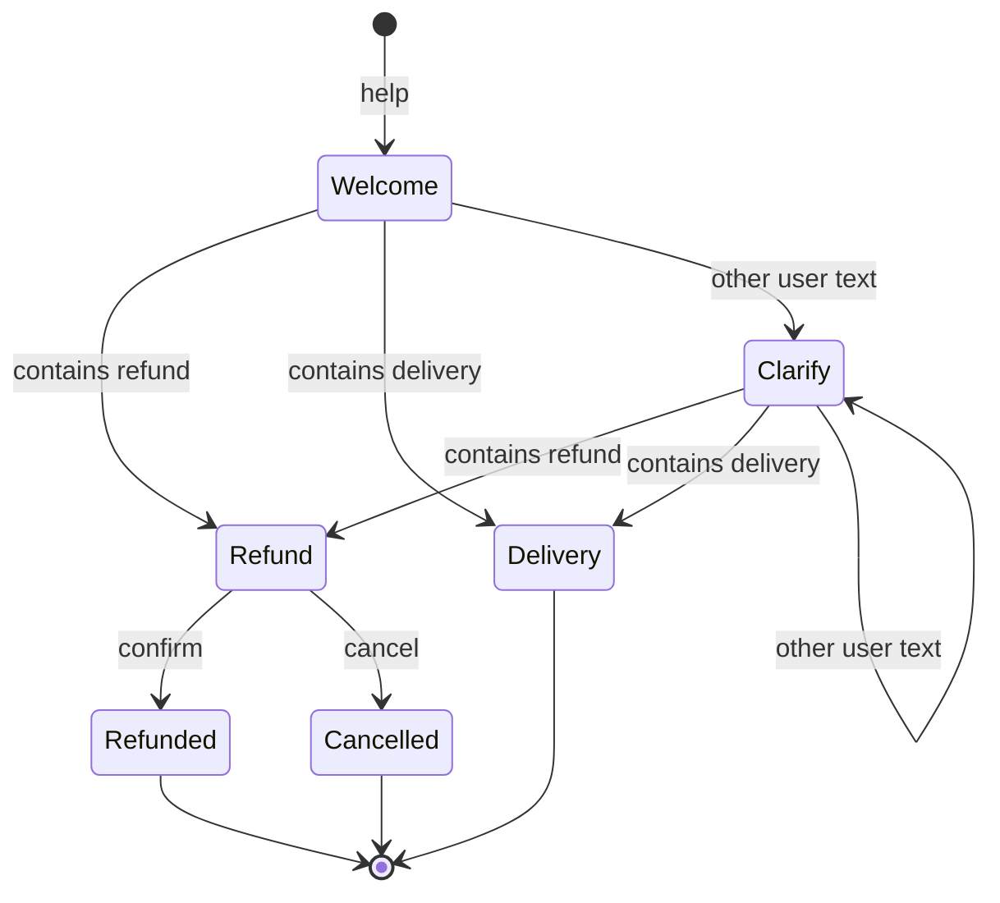

# LLM Test Server

[](https://github.com/managedcode/LlmTestServer/actions/workflows/ci.yml)
[](https://github.com/managedcode/LlmTestServer/actions/workflows/release.yml)
[](https://www.nuget.org/packages/ManagedCode.LlmTestServer)
[](https://github.com/orgs/managedcode/packages/container/package/llm-test-server)
[](LICENSE)

**Deterministic LLM APIs for your tests — in .NET, Python, TypeScript or any other stack.
See exactly what your app sent and where every token went.**

[llmtest.managed-code.com](https://llmtest.managed-code.com)

[](docs/images/showcase-token-flow.jpg)

| Every request, in context | All traffic at a glance |
| --- | --- |
| [](docs/images/showcase-overview.jpg) | [](docs/images/showcase-insights.jpg) |

## What it is

LLM Test Server is a local server that answers like an LLM provider — OpenAI, Anthropic, Gemini and ten more — but
returns exactly what your test scripted. Your app keeps its official SDK and only changes the base URL.

- **The same answer on every run.** Script replies, streams, tool calls, rate limits and content filters.
- **Conversations that branch.** Model support flows with conditions, alternate paths and loops.
- **Your real code path.** Requests travel through the provider SDKs and wire formats you use in production.
- **Every token visible.** The dashboard splits each prompt into system prompt, tool schemas, history and tool results,
  and shows how much the prompt cache served.
- **Any stack.** NuGet packages and an Aspire integration for .NET; one Docker image for everything else.

## How it works

1. **Start the server** — one `docker run`, or one line in your Aspire AppHost.
2. **Choose the answer** — script replies with the typed .NET client or [admin API](docs/Reference/AdminApi.md).
3. **Call it with your SDK** — point the base URL at `http://localhost:8080/openai/v1`, `/anthropic/v1`,
   `/gemini/v1beta` or another [provider namespace](#providers).

Then open `http://localhost:8080` to see the request, the response and the token flow.

## Quick start

[](#quick-start)
[](#python)
[](#typescript--javascript)
[](#c)
[](#net-and-aspire)

### 1. Start the server

```sh
docker run --rm --name llm-test-server -p 8080:8080 \
  -e LlmTestServer__RequiredBearerToken=test-key \
  ghcr.io/managedcode/llm-test-server:1.0.0
```

### 2. Configure the chat

Choose the model ID and the replies your test should receive. This example uses
[GPT-6.1 Sol](https://developers.openai.com/api/docs/models/gpt-6.1-sol) and two replies about an order.

**From .NET**, use the typed control client below. **From Python, JavaScript or any other stack**, send the
[equivalent HTTP configuration](docs/Reference/AdminApi.md#configure-a-chat) to `POST /admin-api/configure`.
Both configure the same running server; choose one.

```sh
dotnet add package ManagedCode.LlmTestServer.Client
```

```csharp
using ManagedCode.LlmTestServer.Client;

using var http = new HttpClient { BaseAddress = new Uri("http://localhost:8080") };
var control = new LlmTestServerClient(http, "test-key");
await control.ConfigureAsync(config => config
    .RequireBearerToken("test-key")
    .UseChatModel("gpt-6.1-sol")
    .UseChatScenario("delivery", scenario => scenario
        .ForModel("gpt-6.1-sol")
        .Responds("Your order arrives on Friday.")
        .Responds("Delivery is free.")));
```

Each `Responds(...)` adds one reply to the queue. The first request gets `Your order arrives on Friday.`;
the second gets `Delivery is free.`. Both support normal and streaming calls. After two requests the queue
is exhausted: reset it with `POST /admin-api/reset`, or `await control.ResetAsync()` in .NET.

### 3. Call it with your SDK

Choose **one** language example below. Each sends two requests: one normal, one streaming.
Reset before switching languages or rerunning an example.

These are standard calls to the official OpenAI SDKs for [C#](https://github.com/openai/openai-dotnet),
[Python](https://github.com/openai/openai-python) and [TypeScript/JavaScript](https://github.com/openai/openai-node).
Your application changes only the endpoint and test API key. The server supplies the scripted response,
stream chunks and token usage; it never calls a real model.

### C\#

```sh
dotnet add package OpenAI
```

Create the client and request a complete response:

```csharp
using System.ClientModel;
using OpenAI;
using OpenAI.Chat;

var chat = new ChatClient(
    "gpt-6.1-sol",
    new ApiKeyCredential("test-key"),
    new OpenAIClientOptions
    {
        Endpoint = new Uri("http://localhost:8080/openai/v1"),
    });

ChatCompletion reply = await chat.CompleteChatAsync("When will my order arrive?");
Console.WriteLine(reply.Content[0].Text); // Your order arrives on Friday.
```

Stream the next response with the same client:

```csharp
await foreach (var update in chat.CompleteChatStreamingAsync("Is delivery free?"))
{
    foreach (var part in update.ContentUpdate)
    {
        Console.Write(part.Text);
    }
}
// Delivery is free.
```

### Python

```sh
pip install openai
```

Create the client and request a complete response:

```python
from openai import OpenAI

client = OpenAI(
    base_url="http://localhost:8080/openai/v1",
    api_key="test-key",
)
reply = client.chat.completions.create(
    model="gpt-6.1-sol",
    messages=[{"role": "user", "content": "When will my order arrive?"}],
)
print(reply.choices[0].message.content)  # Your order arrives on Friday.
```

Stream the next response with the same client:

```python
stream = client.chat.completions.create(
    model="gpt-6.1-sol",
    messages=[{"role": "user", "content": "Is delivery free?"}],
    stream=True,
)
for chunk in stream:
    if chunk.choices:
        print(chunk.choices[0].delta.content or "", end="", flush=True)
# Delivery is free.
```

### TypeScript / JavaScript

```sh
npm install openai
```

The same code works in TypeScript or a JavaScript ES module (`.mjs`).
Create the client and request a complete response:

```ts
import OpenAI from "openai";

const client = new OpenAI({
  baseURL: "http://localhost:8080/openai/v1",
  apiKey: "test-key",
});
const reply = await client.chat.completions.create({
  model: "gpt-6.1-sol",
  messages: [{ role: "user", content: "When will my order arrive?" }],
});
console.log(reply.choices[0].message.content); // Your order arrives on Friday.
```

Stream the next response with the same client:

```ts
const stream = await client.chat.completions.create({
  model: "gpt-6.1-sol",
  messages: [{ role: "user", content: "Is delivery free?" }],
  stream: true,
});
for await (const chunk of stream) {
  process.stdout.write(chunk.choices[0]?.delta.content ?? "");
}
// Delivery is free.
```

Open `http://localhost:8080` to inspect both requests, their responses and token usage.
To change the fixtures or inspect requests from your tests, see the
[admin API reference](docs/Reference/AdminApi.md).
For other providers, use their official SDK with the corresponding
[provider namespace](docs/Reference/ProvidersAndRoutes.md).

## .NET and Aspire

```sh
dotnet add package ManagedCode.LlmTestServer.Aspire
dotnet add package ManagedCode.LlmTestServer.Client
```

In your AppHost — the server runs as a .NET process, no Docker needed:

```csharp
using ManagedCode.LlmTestServer.Aspire;

var builder = DistributedApplication.CreateBuilder(args);
var llm = builder.AddLlmTestServer().WithApiKey("test-key");

builder.AddProject<Projects.Api>("api")
    .WithEnvironment("OPENAI_ENDPOINT", llm.GetOpenAiEndpoint())
    .WithEnvironment("OPENAI_API_KEY", "test-key")
    .WaitFor(llm);

builder.Build().Run();
```

For a complete test that starts Aspire, configures a dialogue, calls the official SDK and verifies the replies,
see the [Aspire integration test](docs/Reference/Clients.md#complete-aspire-dialogue-test).
To embed the server and dashboard in an ASP.NET Core app, see [hosting](docs/Reference/Installation.md).

## Test conversations that branch

Test the paths your users actually take. A conversation graph chooses the next reply from the latest message
and the current state. Here, a customer can track a delivery or request a refund, then confirm or cancel it.
Unrecognized input asks them to choose again.



### Configure and run it with .NET and Aspire

This complete example starts the packaged server as a .NET process, configures the graph through
`LlmTestServerClient`, and runs the refund branch through `IChatClient` over HTTP.
Aspire allocates the server address and stops it when `app` is disposed.

In a .NET 10 console project using `<Project Sdk="Aspire.AppHost.Sdk/13.6.2">`, install:

```sh
dotnet add package ManagedCode.LlmTestServer.Aspire
dotnet add package ManagedCode.LlmTestServer.Client
dotnet add package Aspire.Hosting.Testing
dotnet add package Microsoft.Extensions.AI
```

```csharp
using Aspire.Hosting.Testing;
using ManagedCode.LlmTestServer.Aspire;
using ManagedCode.LlmTestServer.Client;
using Microsoft.Extensions.AI;

var builder = DistributedApplicationTestingBuilder.Create([]);
builder.AddLlmTestServer("llm").WithApiKey("test-key");
await using var app = await builder.BuildAsync();
await app.StartAsync();
await app.ResourceNotifications.WaitForResourceHealthyAsync("llm");

using var http = app.CreateHttpClient("llm", "http");
var control = new LlmTestServerClient(http, "test-key");
await control.ConfigureAsync(config => config
    .RequireBearerToken("test-key")
    .UseChatModel("gpt-6.1-sol")
    .UseConversation("support", graph => graph
        .ForModel("gpt-6.1-sol")
        .WithMaxSteps(12)
        .Step("welcome", step => step.WhenLatestUserEquals("help")
            .Responds("Do you need a refund or delivery tracking?")
            .Then("refund", "delivery", "clarify"))
        .Step("refund", step => step.WhenLatestUserContains("refund")
            .Responds("Reply confirm or cancel.").Then("refunded", "cancelled"))
        .Step("refunded", step => step.WhenLatestUserEquals("confirm")
            .Responds("Your refund is complete.").Complete())
        .Step("cancelled", step => step.WhenLatestUserEquals("cancel")
            .Responds("Your order is unchanged.").Complete())
        .Step("delivery", step => step.WhenLatestUserContains("delivery")
            .Responds("Your order arrives on Friday.").Complete())
        .Step("clarify", step => step.WhenLatestRole("user")
            .Responds("Please choose refund or delivery.")
            .Then("refund", "delivery", "clarify"))));

using var conversation = control.ForConversation("refund-test");
using var chat = conversation.Control.CreateChatClient("gpt-6.1-sol");
List<ChatMessage> messages = [];
foreach (var text in new[] { "help", "refund", "confirm" })
{
    messages.Add(new ChatMessage(ChatRole.User, text));
    var reply = await chat.GetResponseAsync(messages);
    Console.WriteLine(reply.Text);
    messages.Add(new ChatMessage(ChatRole.Assistant, reply.Text));
}
```

Expected replies: `Do you need a refund or delivery tracking?` → `Reply confirm or cancel.` →
`Your refund is complete.`. `ForConversation(...)` adds the conversation header to every request.

Try `help` → `refund` → `confirm`, or `help` → `something else` → `delivery`.
Send the full message history, including assistant replies, on each SDK call. Give each conversation its own
`X-Llm-Test-Server-Conversation` header to keep their states separate.
Targets are checked in `Then(...)` order; the first match wins, so the catch-all comes last.
Text matching is case-sensitive, and this graph stops after at most 12 executed steps.

Steps can also match JSON fields, tool results and logical turns, return tool calls or scripted failures, and
stream replies. Configure the same graph from any language through the
[admin API](docs/Reference/AdminApi.md#configure-a-branching-conversation).
See [conversation rules and lifecycle](docs/Features/ConversationDSL.md) for all conditions and
[a complete SDK dialogue](docs/Reference/AdminApi.md#run-the-conversation) to run it with message history.
Inspect the selected path through [conversation diagnostics](docs/Reference/AdminApi.md#conversations-and-match-explanations).

## Token usage and prompt-cache hits

Every chat request gets deterministic usage from the server's tokenizer, returned in each provider's own usage fields.

- **What the input is made of** — system prompt, tool schemas, user, assistant, tool calls and tool results; the parts
  add up exactly to the reported input.
- **What the prompt cache served** — cache reads and writes follow each provider's rules.
- **What the model produced** — output tokens, with reasoning tokens counted on their own.

The dashboard's **Tokens** tab draws it for one request or a whole conversation, and **Traffic insights** charts all
recorded calls. Tests read the same numbers from the request journal. Details:
[token usage and prompt cache](docs/Reference/TokenUsageAndPromptCache.md) ·
[dashboard analytics](docs/Features/DashboardAnalytics.md).

## What you can do

| Capability | Guide |
| --- | --- |
| Configure and reset the server, inspect requests, verify calls, manage sessions | [Admin API](docs/Reference/AdminApi.md) |
| Chat scenarios: prompt matching, queued replies, streaming chunks, delays, scripted errors | [Configuration](docs/Reference/Configuration.md) |
| Tool calls and structured output, including failing tools | [Tools](docs/Features/ToolAndStructuredFixtures.md) · [Tool faults](docs/Features/ToolFaultFixtures.md) |
| Multi-turn conversations as typed step graphs | [Conversation DSL](docs/Features/ConversationDSL.md) |
| Rate limits (429) and content filters on every provider | [Fault simulation](docs/Reference/Configuration.md#fault-simulation) |
| Embeddings, images, speech, transcription and video | [Modalities](docs/Reference/Configuration.md#modalities) |
| Parallel tests with isolated sessions | [Test sessions](docs/Features/TestSessions.md) |
| Verify what was sent: journal queries, counts, order, tool arguments | [Verification](docs/Features/RequestVerificationAndDeterminism.md) |

The server never calls a real model, and nothing is hidden behind retries or randomness.

## Providers

| Provider | Namespace | Provider | Namespace |
| --- | --- | --- | --- |
| OpenAI | `/openai` | Mistral | `/mistral` |
| Azure OpenAI | `/azure-openai` | Ollama | `/ollama` |
| Microsoft Foundry | `/microsoft-foundry` | Cohere | `/cohere` |
| Anthropic | `/anthropic` | Amazon Bedrock | `/bedrock` |
| Gemini | `/gemini` | OpenRouter | `/openrouter` |
| Groq | `/groq` | DeepSeek | `/deepseek` |
| Perplexity | `/perplexity` | TypeSafe Jev / Kev | `/systemone` |
| Cloudflare Clef | `/cloudflare` | | |

Supported operations differ by provider — check the [operation coverage](docs/Features/ProviderApiContractCoverage.md).

**TypeSafe** is the provider and **Jev** its model family; System One is the native API at
`POST /systemone/v1/systemone`. Use `ManagedCode.LlmTestServer.SystemOne` for its contracts and
`control.CreateSystemOneClient()` from the Client package —
[TypeSafe/Jev example](docs/Reference/Clients.md#typesafe-jev-through-system-one).

## Packages

| Package | NuGet | Use it to |
| --- | --- | --- |
| [ManagedCode.LlmTestServer.Aspire](https://www.nuget.org/packages/ManagedCode.LlmTestServer.Aspire) | [](https://www.nuget.org/packages/ManagedCode.LlmTestServer.Aspire) | start the server from an Aspire AppHost or test |
| [ManagedCode.LlmTestServer.Client](https://www.nuget.org/packages/ManagedCode.LlmTestServer.Client) | [](https://www.nuget.org/packages/ManagedCode.LlmTestServer.Client) | script fixtures and verify recorded requests |
| [ManagedCode.LlmTestServer.Hosting](https://www.nuget.org/packages/ManagedCode.LlmTestServer.Hosting) | [](https://www.nuget.org/packages/ManagedCode.LlmTestServer.Hosting) | host the server and dashboard in your ASP.NET Core app |
| [ManagedCode.LlmTestServer](https://www.nuget.org/packages/ManagedCode.LlmTestServer) | [](https://www.nuget.org/packages/ManagedCode.LlmTestServer) | build on the provider-neutral runtime |
| [ManagedCode.LlmTestServer.OpenAI](https://www.nuget.org/packages/ManagedCode.LlmTestServer.OpenAI) | [](https://www.nuget.org/packages/ManagedCode.LlmTestServer.OpenAI) | use OpenAI wire contracts and compatibility adapters |
| [ManagedCode.LlmTestServer.AzureOpenAI](https://www.nuget.org/packages/ManagedCode.LlmTestServer.AzureOpenAI) | [](https://www.nuget.org/packages/ManagedCode.LlmTestServer.AzureOpenAI) | use Azure OpenAI compatibility contracts and adapters |
| [ManagedCode.LlmTestServer.Foundry](https://www.nuget.org/packages/ManagedCode.LlmTestServer.Foundry) | [](https://www.nuget.org/packages/ManagedCode.LlmTestServer.Foundry) | use Microsoft Foundry compatibility contracts and adapters |
| [ManagedCode.LlmTestServer.Anthropic](https://www.nuget.org/packages/ManagedCode.LlmTestServer.Anthropic) | [](https://www.nuget.org/packages/ManagedCode.LlmTestServer.Anthropic) | use Anthropic Messages contracts and adapters |
| [ManagedCode.LlmTestServer.Gemini](https://www.nuget.org/packages/ManagedCode.LlmTestServer.Gemini) | [](https://www.nuget.org/packages/ManagedCode.LlmTestServer.Gemini) | use Google Gemini compatibility contracts and adapters |
| [ManagedCode.LlmTestServer.Groq](https://www.nuget.org/packages/ManagedCode.LlmTestServer.Groq) | [](https://www.nuget.org/packages/ManagedCode.LlmTestServer.Groq) | use Groq compatibility contracts and adapters |
| [ManagedCode.LlmTestServer.Mistral](https://www.nuget.org/packages/ManagedCode.LlmTestServer.Mistral) | [](https://www.nuget.org/packages/ManagedCode.LlmTestServer.Mistral) | use Mistral compatibility contracts and adapters |
| [ManagedCode.LlmTestServer.Ollama](https://www.nuget.org/packages/ManagedCode.LlmTestServer.Ollama) | [](https://www.nuget.org/packages/ManagedCode.LlmTestServer.Ollama) | use Ollama compatibility contracts and adapters |
| [ManagedCode.LlmTestServer.Cohere](https://www.nuget.org/packages/ManagedCode.LlmTestServer.Cohere) | [](https://www.nuget.org/packages/ManagedCode.LlmTestServer.Cohere) | use Cohere compatibility contracts and adapters |
| [ManagedCode.LlmTestServer.Bedrock](https://www.nuget.org/packages/ManagedCode.LlmTestServer.Bedrock) | [](https://www.nuget.org/packages/ManagedCode.LlmTestServer.Bedrock) | use Amazon Bedrock compatibility contracts and adapters |
| [ManagedCode.LlmTestServer.OpenRouter](https://www.nuget.org/packages/ManagedCode.LlmTestServer.OpenRouter) | [](https://www.nuget.org/packages/ManagedCode.LlmTestServer.OpenRouter) | use OpenRouter compatibility contracts and adapters |
| [ManagedCode.LlmTestServer.DeepSeek](https://www.nuget.org/packages/ManagedCode.LlmTestServer.DeepSeek) | [](https://www.nuget.org/packages/ManagedCode.LlmTestServer.DeepSeek) | use DeepSeek compatibility contracts and adapters |
| [ManagedCode.LlmTestServer.Perplexity](https://www.nuget.org/packages/ManagedCode.LlmTestServer.Perplexity) | [](https://www.nuget.org/packages/ManagedCode.LlmTestServer.Perplexity) | use Perplexity compatibility contracts and adapters |
| [ManagedCode.LlmTestServer.SystemOne](https://www.nuget.org/packages/ManagedCode.LlmTestServer.SystemOne) | [](https://www.nuget.org/packages/ManagedCode.LlmTestServer.SystemOne) | use TypeSafe/Jev native System One decision contracts |
| [ManagedCode.LlmTestServer.Cloudflare](https://www.nuget.org/packages/ManagedCode.LlmTestServer.Cloudflare) | [](https://www.nuget.org/packages/ManagedCode.LlmTestServer.Cloudflare) | use native Cloudflare Workers AI decision contracts |

## Build your next test

| Run the server | Shape the response | Connect your app |
| --- | --- | --- |
| [**Installation & hosting →**](docs/Reference/Installation.md) | [**Scenarios & fixtures →**](docs/Reference/Configuration.md) | [**Clients & SDKs →**](docs/Reference/Clients.md) |
| Choose Docker, Aspire or your own ASP.NET Core host. | Script a dialogue, stream tokens or trigger a failure. | Call the server with the SDK your app already uses. |

Configure or verify a test through HTTP: [admin API reference](docs/Reference/AdminApi.md).
Looking for a provider endpoint? Check [providers & routes](docs/Reference/ProvidersAndRoutes.md).
Contributing? Start with the [architecture](docs/Architecture.md).

---

<p align="center">
  <strong>Predictable answers. Real SDKs. Tests you can trust.</strong><br>
  Built by <a href="https://managed-code.com">Managed Code</a><br>
  <a href="https://llmtest.managed-code.com">Website</a> ·
  <a href="https://github.com/managedcode/LlmTestServer">GitHub</a> ·
  <a href="LICENSE">MIT License</a><br>
  <sub>Copyright © 2026 Managed Code</sub>
</p>
