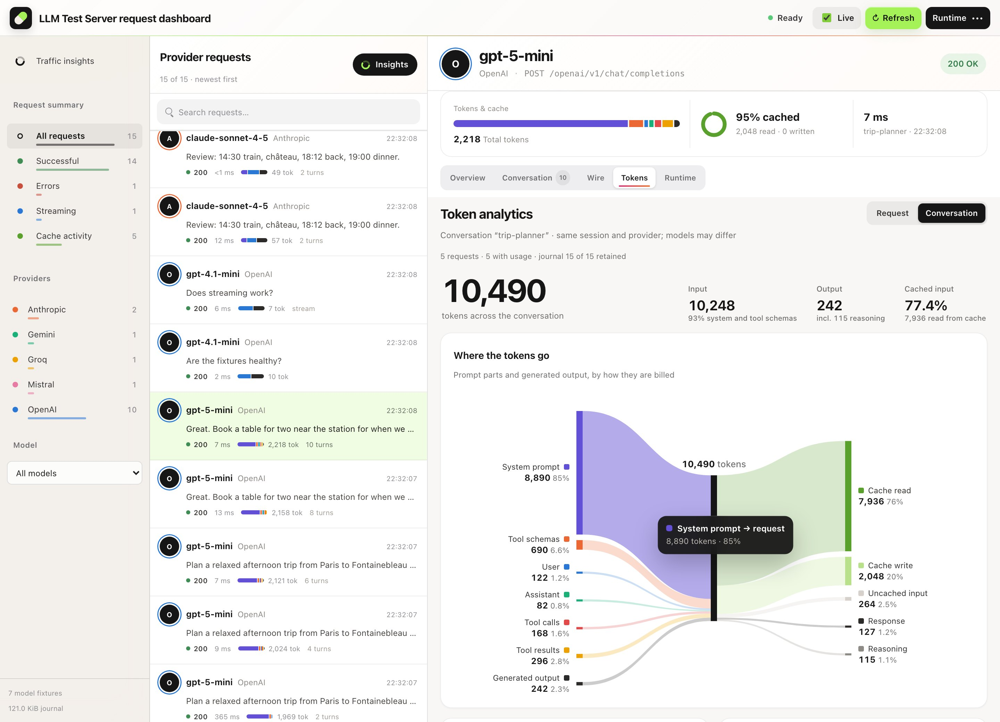
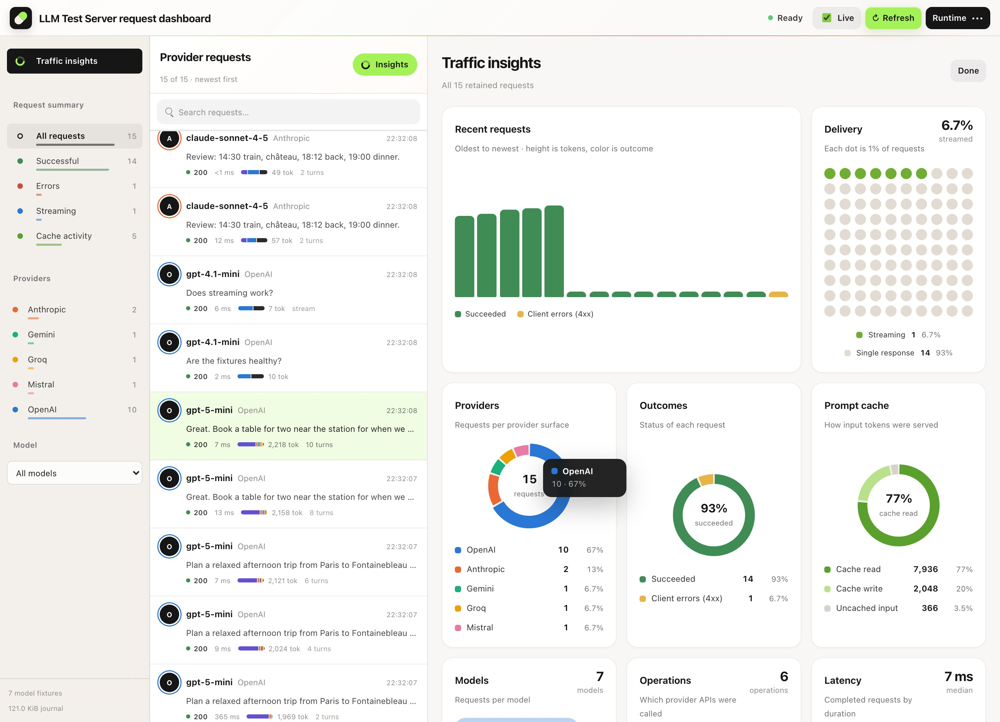
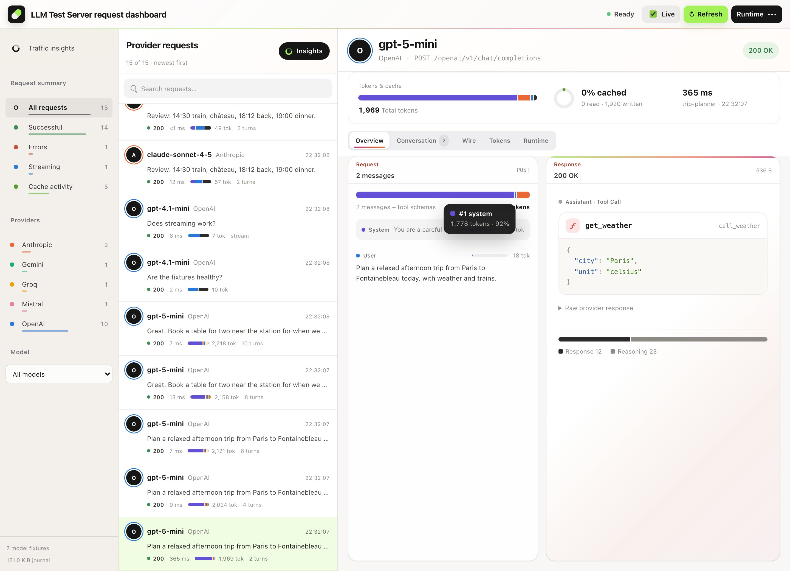
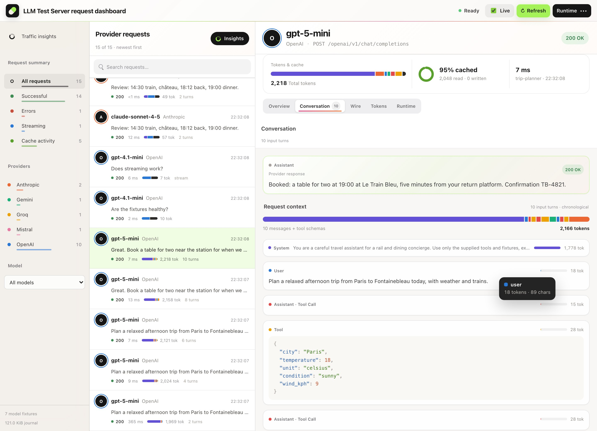
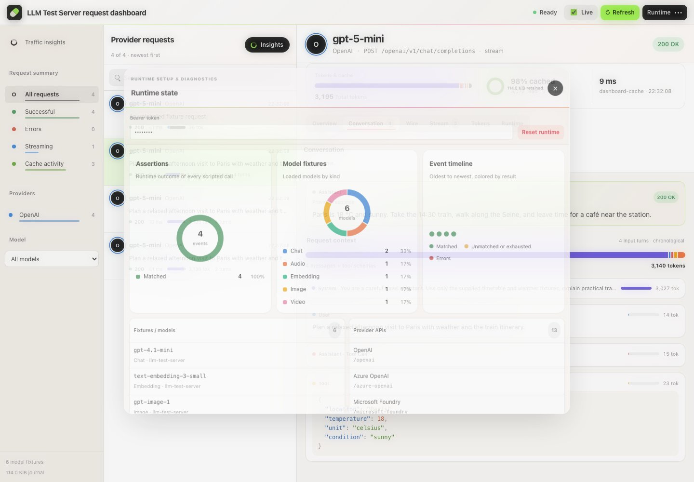

# LLM Test Server

[](https://github.com/managedcode/LlmTestServer/actions/workflows/ci.yml)
[](https://github.com/managedcode/LlmTestServer/actions/workflows/release.yml)
[](https://www.nuget.org/packages/ManagedCode.LlmTestServer)
[](LICENSE)

**A local, deterministic LLM provider for .NET tests, with a dashboard that shows where every token goes.**

[](docs/images/showcase-token-flow.jpg)

[What it is](#what-it-is) · [Token usage and cache hits](#token-usage-and-prompt-cache-hits) · [Quick start](#quick-start) · [Capabilities](#what-you-can-do) · [Providers](#providers) · [TypeSafe / Jev](#typesafe-and-jev) · [Docs](#learn-more)

## What it is

LLM Test Server is a small ASP.NET Core server that speaks the HTTP APIs of 13 LLM providers, each under its own
namespace: `/openai/v1`, `/anthropic/v1`, `/gemini/v1beta`, `/azure-openai`, and so on. Your application keeps its
official SDK or `Microsoft.Extensions.AI` client and only changes the base URL. Every answer, tool call, stream chunk
and failure comes from a fixture your test configures, so the same test produces the same result on every run — with
no external model calls and no production credentials. Run it from an Aspire AppHost, inside your own ASP.NET Core host,
or as a standalone container.

Native decision APIs are included too: **TypeSafe Jev**, Kev through System One, and Cloudflare Clef.
Use the typed client from `ManagedCode.LlmTestServer.Client` with the contracts in
`ManagedCode.LlmTestServer.SystemOne` — see the [TypeSafe/Jev example](docs/Reference/Clients.md#typesafe-jev-through-system-one).

## Why use it

- **Deterministic tests for LLM features.** Script answers, tool calls, multi-turn conversations, streams, rate limits
  and content filters instead of mocking SDK internals.
- **Your real integration code runs.** Requests travel through the same provider SDKs and wire formats your
  application uses in production.
- **Proof of what your application sent.** Every request is recorded with its messages, payloads, usage and outcome;
  tests can query, export and verify that journal.
- **Token and cache visibility.** See how much of each prompt is system text, tool schemas or tool results, and how
  much of it the prompt cache served.
- **Safe in parallel.** Isolated sessions give each test its own configuration, queues, cache and journal on one
  shared server.

## Token usage and prompt-cache hits

Every chat request gets deterministic token usage from the server's tokenizer, and the provider response carries it in
that provider's own usage fields. Three things are tracked for each request:

- **What the input is made of.** Input tokens are split by role — system prompt, tool schemas, user, assistant text,
  tool-call arguments and tool results. The parts add up exactly to the reported input and are recorded as
  `InputComposition` on the request's usage.
- **How the prompt cache served it.** A repeated prompt prefix reports cache reads; the first request that makes a
  prefix cacheable reports cache writes. Thresholds follow each provider (for example 1,024 tokens in 128-token steps on
  OpenAI-compatible routes, 2,048 on Gemini, and explicit cache markers on Anthropic and Bedrock).
- **What the model produced.** Output tokens, with reasoning tokens for reasoning-capable fixture models reported
  separately.

Read it from a test through the request journal (`GET /admin-api/requests`):

```csharp
var journal = await control.GetRequestsAsync();
foreach (var request in journal.Requests)
{
    if (request.Usage is not { InputComposition: { } parts } usage) continue;
    Console.WriteLine($"{request.ModelId}: {usage.InputTokens} input = {parts.SystemTokens} system + " +
        $"{parts.ToolDefinitionTokens} tool schemas + {parts.UserTokens} user + {parts.AssistantTokens} assistant + " +
        $"{parts.ToolCallTokens} tool calls + {parts.ToolResultTokens} tool results + {parts.OtherTokens} other; " +
        $"{usage.CachedInputTokens} read from cache, {usage.CacheCreationInputTokens} written");
}
```

Or open the dashboard: the **Tokens** tab draws the flow above for one request or a whole labeled conversation, with
context-mix and prompt-cache donuts and per-request context growth. **Traffic insights** (`/?view=insights`) charts
all recorded traffic by provider, model, outcome, latency, cache and context mix; clicking a slice filters the inbox.

[](docs/images/showcase-insights.jpg)

Details: [dashboard analytics](docs/Features/DashboardAnalytics.md) ·
[token usage and prompt-cache accounting](docs/Reference/TokenUsageAndPromptCache.md).

## Quick start

> **Status:** the v1.0.0 NuGet packages and container image are not published yet. Until they are, build and pack
> the repository (version `0.1.18`) and use the local feed — see [installation](docs/Reference/Installation.md).

Install the libraries in your existing AppHost or integration-test project from the locally packed feed:

```sh
dotnet add package ManagedCode.LlmTestServer.Aspire --version 0.1.18 --no-restore
dotnet add package ManagedCode.LlmTestServer.Client --version 0.1.18 --no-restore
dotnet restore --source /absolute/path/to/LlmTestServer/artifacts/packages \
  --source https://api.nuget.org/v3/index.json
```

### In an Aspire AppHost

`AddLlmTestServer()` starts the packaged .NET service; Docker is not required.

```csharp
using ManagedCode.LlmTestServer.Aspire;

var builder = DistributedApplication.CreateBuilder(args);
var llm = builder.AddLlmTestServer().WithApiKey("test-key");

builder.AddProject<Projects.Api>("api")
    .WithReference(llm)
    .WithEnvironment("OPENAI_ENDPOINT", llm.GetOpenAiEndpoint())
    .WithEnvironment("OPENAI_API_KEY", "test-key")
    .WaitFor(llm);

builder.Build().Run();
```

### In a test

Add `ManagedCode.LlmTestServer.Aspire`, `ManagedCode.LlmTestServer.Client` and `Aspire.Hosting.Testing`, then
configure a response and call it:

```csharp
using Aspire.Hosting.Testing;
using ManagedCode.LlmTestServer.Aspire;
using ManagedCode.LlmTestServer.Client;
using Microsoft.Extensions.AI;
using ChatMessage = Microsoft.Extensions.AI.ChatMessage;

var builder = DistributedApplicationTestingBuilder.Create([]);
builder.AddLlmTestServer("llm").WithApiKey("test-key");
await using var app = await builder.BuildAsync();
await app.StartAsync();
await app.ResourceNotifications.WaitForResourceHealthyAsync("llm");

var control = new LlmTestServerClient(app.CreateHttpClient("llm", "http"), "test-key");
await control.ConfigureAsync(config => config.RequireBearerToken("test-key").UseGpt41Mini()
    .UseChatScenario("greeting", scenario => scenario.WhenUserContains("hello").Responds("Hello from your test!")));
using var chat = control.CreateChatClient();
var reply = await chat.GetResponseAsync([new ChatMessage(ChatRole.User, "hello")]); // "Hello from your test!"
```

Your application can use its official SDK against the same server. In the Aspire test above, use its allocated
endpoint and the same fixture key — for example with OpenAI:

```csharp
using System.ClientModel;
using OpenAI;
using OpenAI.Chat;

await control.ResetAsync(); // Reuse the configured fixture for this separate SDK example.
using var providerHttp = app.CreateHttpClient("llm", "http");
var openAiChat = new ChatClient("gpt-4.1-mini", new ApiKeyCredential("test-key"),
    new OpenAIClientOptions { Endpoint = new Uri(providerHttp.BaseAddress!, "openai/v1") });
ChatCompletion completion = await openAiChat.CompleteChatAsync([new UserChatMessage("hello")]);
Console.WriteLine($"{completion.Usage.InputTokenCount} input tokens, " +
    $"{completion.Usage.InputTokenDetails.CachedTokenCount} from cache");
```

### As a standalone container

Build the image with the .NET SDK (use `linux-x64` in both RID arguments on amd64), run it, then configure it over
HTTP — any language can drive it:

```sh
dotnet publish samples/ManagedCode.LlmTestServer.Service/ManagedCode.LlmTestServer.Service.csproj \
  --configuration Release --runtime linux-arm64 --self-contained false \
  /t:PublishContainer -p:ContainerRuntimeIdentifiers=linux-arm64 -p:ContainerImageTag=local -p:UseAppHost=false
docker run --rm -p 8080:8080 -e LlmTestServer__RequiredBearerToken=local-test-key managedcode/llm-test-server:local
```

```sh
curl --fail-with-body http://localhost:8080/admin-api/configure \
  -H 'Authorization: Bearer local-test-key' -H 'Content-Type: application/json' \
  --data '{"requiredBearerToken":"local-test-key","models":[{"id":"gpt-4.1-mini","kind":"chat"}],"chatScenarios":[{"id":"hello","modelId":"gpt-4.1-mini","responses":[{"content":"Hello from your fixture"}]}]}'
curl --fail-with-body http://localhost:8080/openai/v1/chat/completions \
  -H 'Authorization: Bearer local-test-key' -H 'Content-Type: application/json' \
  --data '{"model":"gpt-4.1-mini","messages":[{"role":"user","content":"Hello"}]}'
```

Open `http://localhost:8080/` for the dashboard. When a key is configured it protects provider routes and
`/admin-api/*`. More: [Docker distribution](docs/Features/DockerDistribution.md),
[embedding in ASP.NET Core](docs/Reference/Installation.md#aspnet-core-startup).

## What you can do

| Capability | What it covers | Guide |
| --- | --- | --- |
| Chat scenarios | Contains or exact prompt matching, queued replies, streaming chunks, delays, scripted errors, per-scenario keys | [Configuration](docs/Reference/Configuration.md) |
| Tool calls and structured output | Function calls validated against your schemas, JSON responses, well-known tools, tool failures | [Tools](docs/Features/ToolAndStructuredFixtures.md) · [Well-known tools](docs/Features/WellKnownFunctionTools.md) · [Tool faults](docs/Features/ToolFaultFixtures.md) |
| Multi-turn conversations | Typed step graphs with branches, tool-result checks and terminal states | [Conversation DSL](docs/Features/ConversationDSL.md) |
| Streaming | Provider-native SSE and NDJSON streams with usage where the provider reports it, plus delivery faults | [Stream delivery faults](docs/Features/StreamDeliveryFaults.md) |
| Failure paths | 429 rate limits and content filters on every provider family | [Fault simulation](docs/Reference/Configuration.md#fault-simulation) |
| More than text | Embeddings, images, speech, transcription, translation and video jobs | [Modalities](docs/Reference/Configuration.md#modalities) |
| Native provider tools | OpenAI web search, file search and code; Anthropic web search; Responses continuation | [OpenAI web search](docs/Features/OpenAiNativeWebSearch.md) · [File/code](docs/Features/OpenAiNativeFileCode.md) · [Anthropic](docs/Features/AnthropicNativeWebSearch.md) · [Continuation](docs/Features/ResponsesContinuation.md) |
| Parallel tests | Isolated sessions with their own configuration, queues, cache and journal | [Test sessions](docs/Features/TestSessions.md) |
| Verification | Query and export the request journal, verify counts, order and tool arguments, fix IDs and clocks | [Verification and determinism](docs/Features/RequestVerificationAndDeterminism.md) |
| Native decision APIs | TypeSafe Jev, Kev (System One), Cloudflare Clef, OpenAI Decisions | [Decision contracts](docs/Features/DecisionModels.md) · [Jev 1.14](docs/Features/Jev114.md) |
| Official SDKs | OpenAI, Azure OpenAI, Foundry, Anthropic, Google Gen AI, Bedrock and `Microsoft.Extensions.AI` | [Clients and SDKs](docs/Reference/Clients.md) · [SDK compatibility](docs/Features/ProviderSdkCompatibility.md) |

Everything is a fixture you choose: nothing is hidden behind retries or randomness, and the server never calls a real
model.

## Dashboard tour

The dashboard at `/` is a request inbox: one row per provider call, with the full request, response, conversation,
payloads, stream chunks, tokens and runtime result one click away.

| Request overview | Conversation | Runtime diagnostics |
| --- | --- | --- |
| [](docs/images/showcase-overview.jpg) | [](docs/images/showcase-conversation.jpg) | [](docs/images/admin-dashboard-runtime.jpg) |
| What was sent, what came back, and what it cost in tokens. | Each turn with its role and token share. | Fixtures, provider routes, assertions and the event timeline. |

## Providers

Each provider family lives under its own namespace and keeps its native request and response shapes.

| Provider | Namespace | Provider | Namespace |
| --- | --- | --- | --- |
| OpenAI | `/openai` | Mistral | `/mistral` |
| Azure OpenAI | `/azure-openai` | Ollama | `/ollama` |
| Microsoft Foundry | `/microsoft-foundry` | Cohere | `/cohere` |
| Anthropic | `/anthropic` | Amazon Bedrock | `/bedrock` |
| Gemini | `/gemini` | OpenRouter | `/openrouter` |
| Groq | `/groq` | DeepSeek | `/deepseek` |
| Perplexity | `/perplexity` | TypeSafe Jev / Kev (System One) | `/systemone` |
| Cloudflare Clef / Clef Flash | `/cloudflare` | | |

Operation coverage differs by provider and grows over time. A provider being listed does not mean every API of that
provider is implemented — check the [operation coverage](docs/Features/ProviderApiContractCoverage.md) and
[routes reference](docs/Reference/ProvidersAndRoutes.md) for the exact contracts.

## TypeSafe and Jev

**TypeSafe is the provider; Jev is its model family. System One is the native API.**
Use `ManagedCode.LlmTestServer.SystemOne` for its request and response contracts, and
`ManagedCode.LlmTestServer.Client` for `control.CreateSystemOneClient()`.
The native server route is `POST /systemone/v1/systemone`.

Configure deterministic answers for predicates, choices, scores and Jev 1.14 bounding boxes.
JSON image assets and multipart uploads are supported with explicit image opt-in.
Kev uses the same protocol package with its own compatibility profile.

[Configure and call Jev from a test](docs/Reference/Clients.md#typesafe-jev-through-system-one) ·
[Jev 1.14 images and limits](docs/Features/Jev114.md) ·
[Native decision fixtures](docs/Features/DecisionModels.md)

## Packages

| Package | Use it for |
| --- | --- |
| `ManagedCode.LlmTestServer.Aspire` | Add the server to an AppHost or Aspire test with `AddLlmTestServer()`. |
| `ManagedCode.LlmTestServer.Client` | Configure, reset, query and verify from tests; `IChatClient`, embedding and image clients. |
| `ManagedCode.LlmTestServer.Hosting` | Embed the server and dashboard in your own ASP.NET Core host. |
| `ManagedCode.LlmTestServer` | The provider-neutral runtime: models, scenarios, usage and assertions. |
| `ManagedCode.LlmTestServer.<Provider>` | Wire contracts for each provider family listed above. |
| `ManagedCode.LlmTestServer.SystemOne` | Native TypeSafe Jev and Kev contracts for the System One API. |
| `ManagedCode.LlmTestServer.Cloudflare` | Native Cloudflare Clef and Clef Flash decision contracts. |

The full list with NuGet links is in [providers, packages and routes](docs/Reference/ProvidersAndRoutes.md#packages).

## Learn more

- [Installation and hosting](docs/Reference/Installation.md) — local feed, container, ASP.NET Core, Aspire, building from source
- [Configuration and scenarios](docs/Reference/Configuration.md) — models, scenarios, modalities, faults, assertions
- [Clients and SDKs](docs/Reference/Clients.md) — control client, official SDKs, `Microsoft.Extensions.AI`, TypeSafe client
- [Token usage and prompt cache](docs/Reference/TokenUsageAndPromptCache.md) and [dashboard analytics](docs/Features/DashboardAnalytics.md)
- [Providers, packages and routes](docs/Reference/ProvidersAndRoutes.md) and [operation coverage](docs/Features/ProviderApiContractCoverage.md)
- [Architecture](docs/Architecture.md), [test inventory](docs/Testing/AcceptanceCriteriaTestInventory.md) and [delivery plan](docs/Features/LlmTestServerDeliveryPlan.md)

## Build from source

```sh
dotnet restore ManagedCode.LlmTestServer.slnx
dotnet build ManagedCode.LlmTestServer.slnx --configuration Release --no-restore
dotnet test --project tests/ManagedCode.LlmTestServer.Tests/ManagedCode.LlmTestServer.Tests.csproj --configuration Release --no-build
```

Packing, coverage and package verification are described in [installation](docs/Reference/Installation.md#build-and-test).

## License

[MIT](LICENSE)
