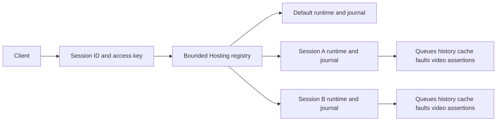

# ADR-0003: Isolated test sessions

Status: Implemented and locally qualified
Date: 2026-10-20
Related feature: [migration plan E2](../Features/LlmTestServerMigrationPlan.md)

## Context and decision

A shared server currently has one runtime and journal. Configure/reset affects every client, so parallel tests can consume each other's queues and erase history. Keep the existing default runtime for callers without session headers. Hosting owns a bounded session registry; each session owns a core runtime and HTTP journal. Request-scoped DI selects the same session for provider mapping, tracing and control endpoints.

`POST /admin-api/sessions` authenticates against the default runtime and accepts an optional `configuration`. Omission clones the startup configuration. The response returns an opaque ID, a random access key and reserved state bytes. Provider/control calls must send both `X-Llm-Test-Server-Session` and `X-Llm-Test-Server-Session-Key`. These headers are independent of provider bearer/API credentials. Unknown IDs, missing/wrong keys and foreign deletion return 404 before tracing or invoking a runtime. Session keys are redacted in diagnostics and never used as provider credentials. Creation responses use `Cache-Control: no-store`.

`DELETE /admin-api/sessions/{id}` requires that session's ID/key pair. It removes the registry entry and resets its runtime, invalidating pending delayed responses through the existing runtime generation contract. Reset/configure inside a session affects only that session. Default reset/configure does not delete sessions. Explicit disposal is the lifetime boundary; there is no background expiration or persistence.

## Bounds and concurrency

`LlmTestServerSessionOptions` sets maximum session count, aggregate reserved state bytes and serialized configuration bytes. Reservations include configured history/video limits, prompt-cache/job/response overhead, journal retention, UTF-16 event retention and the configuration snapshot. This is an admission budget for retained server state, not a measurement of managed heap/transient HTTP allocation. Oversized configuration returns 400; exhausted count/aggregate capacity returns 409. Configure builds a validated replacement runtime, checks admission, then swaps it and retires the previous runtime atomically under the registry gate; invalid configuration is rejected before admission checks. It adjusts the reservation only on success; delete releases it. Existing runtime count/byte limits remain effective within every session. Registry admission/configure/delete is serialized; independent provider requests execute against their own runtimes.

The client exposes `CreateSessionAsync(...)`, a scoped `HttpClient` for official SDK transports, and `Control`. `await using` deletes server state. The wrapper applies headers per request and leaves the caller-owned underlying transport alive, so parallel session clients never mutate shared default headers.

## Alternatives and consequences

- A correlation header on the singleton runtime cannot isolate cursors or reset and is rejected.
- One process per session isolates state but adds AppHost/process lifecycle costs and is rejected for shared-server tests; separate hosts remain supported.
- Ambient mutable singleton selection is rejected because concurrent awaits could cross-contaminate sessions.
- A request DI scope and explicit registry preserve all provider adapters and core state owners. The browser's interactive session selector remains E13 work; the default dashboard continues to inspect the default runtime.

## Verification plan

Use HTTP/official SDK integration tests for simultaneous identical prompts, independent queues, reset/configure/dispose, cross-key access, separate journals/history/cache/fault/video state, count and byte admission, invalid configuration atomicity, streaming/cancellation and delayed in-flight deletion. Run the full provider integration suite, formatter, canonical Release build and unchanged 90% production coverage gate. No unit/source/reflection tests.

## Qualification evidence

The complete integration-only suite passed 655/655 with 91.17% production line coverage. Canonical Release build
and format verification passed with zero warnings/errors. An isolated NuGet consumer restored the repacked
Core/Client/Hosting/Aspire artifacts, started the packaged service with Aspire and verified session API isolation,
provider calls and the interactive Chromium dashboard (1/1). Evidence is under
`artifacts/llm-test-server-migration/session-*`; public NuGet publication belongs to the combined release batch.
