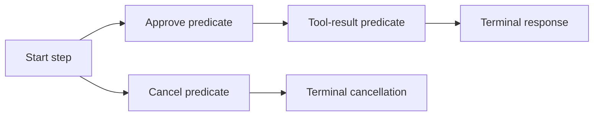

# ADR-0004: Typed conversation step graphs

Status: Accepted; implementation in progress
Date: 2026-10-20
Related: [conversation DSL](../Features/ConversationDSL.md), [delivery E3](../Features/LlmTestServerDeliveryPlan.md),
[test sessions](../Features/TestSessions.md), [architecture](../Architecture.md)

## Decision and context

Linear scenarios match historical messages and consume a linear queue. A workflow needs a condition for each
incoming turn, explicit alternative transitions, tool-result checks, terminal behavior and readable mismatch
reports. Add an optional typed conversation graph to the existing scenario model. Keep linear queues unchanged.
Graphs run inside the existing runtime and inherit session configuration/reset/disposal ownership.

Each step has one response, serializable match predicates and either ordered next-step IDs or an explicit
terminal marker. Predicates cover latest role/text, normalized turn index, tool name/call ID, exact JSON arguments
and JSON-field equality in the latest content. Branch selection uses the declared next-step order. Diagnostic
APIs report selected/shadowed rules, mismatch field names and unvisited steps without consuming state.

## Identity and ordering

`X-Llm-Test-Server-Conversation` optionally selects independent conversations inside one session. The default
is `default`. State is also partitioned by scenario identity, provider namespace and provider credential hash.
A typed conversation client applies its header per request without changing the shared transport's headers.

Logical turn index is one plus the number of consecutive assistant-message groups in the normalized input,
ignoring system/developer messages. Parallel function-call items in Responses form one assistant group. HTTP
attempts do not increment this index. Clients provide full history or use stored Responses continuation.

An identical retry of the last successful normalized request replays the same runtime result and does not
advance the graph. Streaming mode does not create a new logical request. Scripted error steps can explicitly
transition to a recovery step at the same logical turn. Older/changed input at an already successful turn is
rejected. Graphs allow one in-flight step; cancellation and fixture/history-capacity failures roll back their
reservation. Reset/configure/delete invalidate pending work through the runtime generation/lifetime contract.

## Bounds and exhaustion

Runtime configuration bounds conversation count and retained state bytes; admission and response reservations
fail explicitly without eviction. Graphs have bounded step count and execution limits. Terminal policies are
Reject, RepeatLastResponse and Restart. Restart clears execution and visited-step counters for a new run;
the execution limit guards cycles within a run. Normal successful-request replay is independently configurable
and precedes terminal handling. Only the latest successful normalized request is retained for replay.
Unvisited alternative branches are diagnostic information, not proof that an expected active branch was skipped.

## Consequences and implementation

The graph, predicates and responses share the existing configuration snapshot/HTTP contract. Core owns matching,
bounded admission and transition commit/rollback; Hosting passes request identity and exposes diagnostics;
Client owns the typed header wrapper. No new package, persistence layer or executable configuration delegates
are required. Linear scenarios remain unchanged. Graph state and last-result retention add explicit runtime
admission budgets, including sessions' aggregate reservation accounting.

Retained responses enable deterministic runtime replay without promising identical provider-generated wire
IDs or timestamps. State persists until reset/configure/session disposal; local conversation-client disposal
only releases its transport wrapper. Tests must manage that session lifetime explicitly.

Implementation sequence: graph DTO/builders and validation; runtime selection/reservation/replay; hosted identity
and control routes; typed client and diagnostics; HTTP/SDK qualification and installed-consumer verification.
The implementation is locally qualified: the full server integration suite passed 722/722, production line coverage is 91.34%, and the independent installed-package consumer passed 1/1. Public release remains pending the combined delivery batch.

## Alternatives

- Matching every request against all historical user messages cannot identify the current workflow step.
- Embedding server delegates in configuration cannot survive HTTP configuration or fixture export.
- A separate workflow process/store duplicates runtime/session ownership and is unnecessary.

## Verification plan

Run HTTP/provider SDK tool loops and branches, retry/error/terminal flows, JSON predicates, malformed graphs,
capacity, cancellation/reset and credential/provider/conversation isolation. Verify explanations through control
APIs and event metadata. Run the unchanged full integration/coverage gate and installed-package consumer.
The exact commands and acceptance boundaries are maintained in [Conversation DSL](../Features/ConversationDSL.md#verification-and-completion-criteria).
