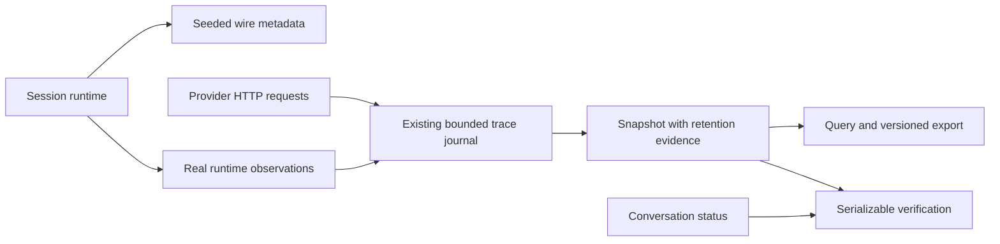

# ADR-0005: Request evidence and seeded wire metadata

Status: Accepted; implemented and locally qualified, public delivery pending
Date: 2026-10-20
Related: [feature contract](../Features/RequestVerificationAndDeterminism.md),
[architecture](../Architecture.md),
[session ownership](ADR-0003-isolated-test-sessions.md), [conversation graphs](ADR-0004-conversation-step-graphs.md).

## Context and decision

Tests need machine-readable request evidence, assertions about complete tool/conversation/retry flows, and
repeatable generated IDs/time. The dashboard already has a bounded request journal. Reusing that journal
keeps UI, query, export and verification aligned; explicit retention counters prevent missing evidence from
being interpreted as a successful assertion.

Keep request evidence in the existing session-owned Hosting journal. Move public trace/query DTOs into core
`Diagnostics`; put serializable expectation DTOs and the pure evaluator in core `Verification`. Hosting captures
real HTTP behavior and exposes authenticated query/export/verify endpoints. Client wraps those contracts.
No second store, new package or recorded-byte cassette format is introduced by this decision.

## Evidence ownership and completeness

Journal sequence identifies observed request ordering, while an attempt ID correlates runtime and HTTP evidence.
Explicit retry-group IDs group attempts without replacing their IDs. Query/export/verification share snapshot
filter semantics. Export version 1 includes query and retention metadata; NDJSON starts with a metadata record.
It is a diagnostic export of retained evidence, not full-fidelity recording.

Eviction, truncation, selected pending requests or omitted matching pages prevent `Passed`, even if retained
requests happen to match expectations. This conservative rule applies to the selected journal and is reset
with its session. Tool assertions use structured request history and response calls, including call/result IDs;
JSON previews are bounded display data and cannot substitute for missing evidence.

Terminal evidence is recorded after a protocol's final marker is successfully written/flushed. Transport EOF
alone is insufficient. Bedrock InvokeModel currently has no explicit marker, so terminal-marker expectations
are inapplicable to that operation. Assertions still inspect its request count, outcome and other available data.

Retry verification uses real monotonic start/completion timestamps for spacing, independently of wall-clock
changes. HTTP-date Retry-After values are interpreted using the observed UTC completion time; elapsed waiting
is compared monotonically. Missing or invalid timing fails completeness. Scripted Retry-After fixtures advertise
policy; the application or real provider SDK performs the retry.

## Wire metadata and lifecycle

Each session runtime owns provider-local request ordinals and optional `LlmTestServerDeterminism` configuration.
At provider request entry it derives immutable `LlmTestServerResponseMetadata` from seed, provider namespace
and ordinal. Domain-derived IDs preserve native provider prefixes. Results and stream chunks reuse that
metadata; stored responses and successful conversation replay retain it. Reset/configure clear counters along
with scenario state. Control reads do not reserve provider ordinals.

Fixed mode controls generated wire fields and HTTP Date. Explicit fixture fields, model dictionaries and video
configuration retain their own values. Event/trace observation timestamps and elapsed/monotonic timing remain
real. Traces expose `WireClockMode`, `WireCreatedAt` and `WireSequence` so callers can distinguish those clocks;
replay enrichment reports retained result metadata rather than the new attempt's initial reservation.
Session identifiers and access keys remain random security credentials. The seed is not a credential.

## Alternatives and consequences

- A second assertion store would introduce separate retention/ordering semantics and duplicate capture.
- A process-global seeded random generator or clock would couple independent sessions and providers.
- Replacing observation time with fixture time would invalidate retry and cancellation evidence.
- Inferring complete assertions from previews or successful EOF would conceal evidence loss and absent markers.

The chosen design provides one bounded evidence source, repeatable fixture identity and observable clock policy.
Its limits are explicit: eviction invalidates complete verification, request entry determines ordering within a
provider under concurrency, and diagnostic exports do not preserve unretained bytes. Tests should use fresh
sessions and adequate retention. Fixed metadata adds no persistence, upstream call or additional executable
configuration mechanism.

## Implementation and verification

Implement core DTO/query/verification contracts; extend the existing journal with sequence/retention counters,
structured tools and real monotonic timing; expose query/export/verify and typed clients; thread wire metadata
through runtime/provider adapters; qualify complete real HTTP/SDK flows and installed-package use.

Verification must prove positive and negative counts/order/tools/graph/retry outcomes, auth/session isolation,
incomplete retention/paging/pending evidence, terminal applicability, fixed seed/reset/replay IDs and independent
session/provider counters. Wire timestamps and real observation timestamps must be independently asserted.
The feature's [verification commands](../Features/RequestVerificationAndDeterminism.md#verification-and-completion-criteria)
include the full integration/format/Release build/coverage gates. Local E4 qualification passed 812/812
integration tests, 91.66% production line coverage, final Release build with zero warnings/errors, all 19 package
builds and the independent clean installed Aspire/official SDK/Chromium consumer (1/1). Evidence logs are listed in the
[feature contract](../Features/RequestVerificationAndDeterminism.md). E4 branch CI and public
publication remain pending; local package acceptance is not public-release evidence.
