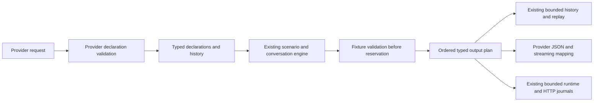

# ADR-0006: Ordered native tool fixtures on the existing conversation engine

Status: Accepted; bounded OpenAI web/file/code contracts locally qualified; public delivery pending
Date: 2026-10-20
Related: [native tool inventory](../Features/NativeBuiltInToolContractInventory.md),
[conversation graphs](ADR-0004-conversation-step-graphs.md),
[request evidence](ADR-0005-request-evidence-and-wire-determinism.md).

## Context and decision

A hosted provider tool returns provider-native call items, citations and lifecycle events. Treating it as a
function call loses its contract and can cause a client to attempt an external function invocation. Separate
text/function/native lists also lose the order of mixed response items and break continuation history.

Add a typed ordered output plan to the existing scenario/conversation response, chat result and retained
assistant history. Keep the current reservation, cancellation, graph progression, replay and session ownership.
The first qualified contract targets completed OpenAI Responses web searches. Bounded completed file-search
and code-interpreter contracts now use the same engine and are locally qualified. Other native
families, broader options and providers remain in E5/E10 and require their own adapters and evidence.
The expanded contract is documented in [OpenAI native file/code fixtures](../Features/OpenAiNativeFileCode.md).

## Boundaries and data

Core owns message/function/web-search/file-search/code fixture data, immutable snapshots, declaration options, semantic validation,
ordering, usage accounting and capacity admission. The provider package owns its request and output unions,
include projection, citation wire fields and streaming events. Hosting enables native contracts only on the
qualified route, reads the request, calls the runtime and writes the mapped response.

`LlmTestServerNativeToolSurface.OpenAiResponses` identifies the qualified route independently from each declaration's
`Contract` (`LlmTestServerNativeToolContract`). The ordered output union includes message, function call, web search, file search and
code interpreter. A separate ordered annotation union retains URL, file and container-file citations without
regrouping annotations by kind. Control JSON uses `kind`; the provider adapter emits the corresponding API
`type` discriminators. Native results remain outside function-call counters.

Explicit output plans and ordinary Content/ToolCalls/StreamChunks are mutually exclusive in configuration.
The engine projects a selected plan once into the existing text/function fields needed by matchers and clients,
while retaining its authoritative ordered items. Ordinary fixtures keep their existing result fields and provider fallback mapping. This avoids two
independently mutable representations in configuration JSON.

Native declarations remain distinct from function definitions. A native result requires a matching declaration
and qualified route/model contract. Named choices, none/required and parallel-call limits are checked against
the complete selected plan before queue or graph consumption. Search domain restrictions apply to scripted
sources and citations. Context/location options are retained for request identity and diagnostics; no live search
is performed. Newer unimplemented native options are rejected explicitly rather than silently discarded.

## History, identity and accounting

All native items and the final assistant message belong to one logical assistant response. Explicit prior output
items and stored-response continuation preserve their types, order, sources and citations. Native items never
become synthetic user JSON or client tool-result messages. Stored-response access retains the existing provider
namespace and credential boundary inside its session runtime. Conversation labels remain correlation/graph
identities; an explicit previous_response_id selects the parent history.

Deep-copy nested collections at configuration, history, replay and journal boundaries. Include native payloads
in existing conversation/history byte limits and journal character budgets. Capacity rejection must not advance
a response/step or mutate the prompt cache. Native declaration options participate in request fingerprints,
cache identity and normalized input usage; native history/result payloads participate in normalized token counts.
Cache and reasoning remain subsets of input/output totals.

Explicit fixture IDs and existing seeded wire metadata preserve deterministic response identities. Native
stream progress, output-item completion, citations and final completion must agree with ordinary JSON output.
The terminal marker is observed only after the final response event has been written and flushed.

## Bounded file/code extension

The current independent model pairings are web search with `gpt-4.1-mini`, file search with `gpt-4o-mini`,
and code interpreter with `gpt-4.1`. Model checks apply to current declarations/choices, while completed prior
outputs remain history on the qualified surface. No common supported model is inferred for mixed native
families from SDK serialization alone.

File search preserves declared store IDs, max-result count, ranker, threshold and bounded comparison/compound
filter trees. Configured results must already meet the count/score/filter restrictions; an admission mismatch
returns 409 without consumption rather than silently rewriting fixture results. Strings compare ordinally;
accepted numbers compare by decimal value, preserving precision in their JSON representation. Missing or
mismatched attribute kinds do not match. Boolean ordering, hybrid ranking and unsupported option fields are
rejected. The filter depth/node limits are explicit fixture limits, not claims about upstream limits.

Code fixtures carry explicit container, input-file and generated-file references, nullable code/outputs and
optional code chunks. Automatic request mode matches the configured input asset set and resolves to the
configured container identity; it does not provision a container. Container-file citations reference that
container and its input or explicitly generated references. Zero-length container citation ranges are permitted;
the existing URL citation boundary remains positive-length. Cited text remains ASCII in this subset.

Results/outputs include projection is provider-owned and leaves authoritative retained data intact. File/code
JSON/SSE, structured diagnostic copies, native cache identity and explicit/stored continuation use the same
bounded state paths. Memory/network controls, actual file retrieval and resource lifecycle remain pending.
The initial 150 HTTP/SDK cases passed; expanded regression and final combined qualification remain pending.

## First contract and remaining breadth

The initial OpenAI contract uses gpt-4.1-mini, completed search actions, typed source URLs, URL citations and
JSON/SSE Responses. The web-search guide reserves open_page/find_in_page for reasoning models; they require
separate model-qualified implementation. The upstream citation schema does not establish an encoding convention
for non-ASCII indexes. The initial cited-text fixture subset is explicitly ASCII, preserving supplied indexes;
uncited text retains normal Unicode support. This boundary is visible in the feature/support inventory and does
not remove Unicode qualification or other native tools from the delivery plan.

No network search, code executor, file downloader, second work queue or unbounded resource registry is added.
Files, vector stores, containers and generated-artifact lifecycle will reuse the appropriate session-owned
bounded state when their E9 contracts are implemented.

## Alternatives and consequences

- A function-name shim would emit the wrong SDK item/event types and misrepresent hosted execution.
- Provider JSON embedded as arbitrary core strings would bypass typed validation, budgets and history semantics.
- A separate native scenario queue would split consumption, cancellation and replay ownership.
- Mapping validation after CompleteChatAsync would reject a fixture only after consuming its queue/graph step.

The chosen model adds explicit union/snapshot handling to existing state paths. Its cost is additional typed
mapping and budget coverage; it keeps one engine and permits later native contracts to reuse ordering and
ownership without pretending they share a provider wire format.

## Verification

Use running ASP.NET endpoints and the installed official Responses SDK. NativeWebSearch*IntegrationTests must
prove typed JSON and streaming, mixed output order, include gating, explicit/stored continuation, named choices,
invalid declarations and atomic configure failure, domain mismatch without consumption, route/model boundaries,
reset/cancellation/replay, credential/session isolation and capacity limits. `NativeFileCodeIntegrationTests` must independently prove file/code models, typed SDK results and citations,
nullable include behavior, filter operators/precision/bounds, explicit/auto resource matching, ordered streaming,
malformed-ID/history rejection and no-consumption behavior. Provider contract/evidence suites and existing
function/structured-output integrations remain mandatory regressions.

Run the repository format check, canonical Release build, complete integration suite and coverage gate; pack
all packages and qualify a clean installed-package consumer before claiming delivery. Qualification results are
recorded in the delivery ledger only after the actual commands pass. Public publication remains the single
owner-approved v1.0.0 launch batch.

## References

- [OpenAI web search](https://developers.openai.com/api/docs/guides/tools-web-search)
- [Responses create](https://developers.openai.com/api/reference/resources/responses/methods/create)
- [Responses streaming schema](https://developers.openai.com/api/reference/resources/responses/streaming-events)

- [OpenAI file search](https://developers.openai.com/api/docs/guides/tools-file-search)
- [OpenAI code interpreter](https://developers.openai.com/api/docs/guides/tools-code-interpreter)
- [File-search model pairing](https://developers.openai.com/cookbook/examples/file_search_responses)
- [Code-interpreter model pairing](https://developers.openai.com/cookbook/examples/mcp/mcp_tool_guide)
