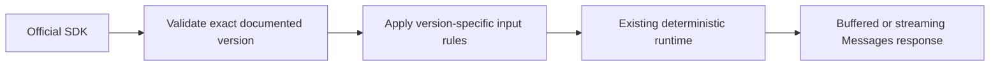

# Anthropic Messages API versions

The Anthropic provider accepts the documented `2023-06-01` and `2026-10-21`
`anthropic-version` headers. Missing, combined and unknown revisions fail with
Anthropic `invalid_request_error`; clients select their own revision. The
current official C# SDK selects `2026-10-21` without a consumer override.

For `2026-10-21`, validation rejects `temperature`, `top_p` and `top_k`, direct
assistant `document` blocks, and non-empty text citations in user messages or
`search_result` content. Validation occurs before scenario consumption. Existing
2023 request semantics remain supported by their existing integration suite.

Sources: [official API version history](https://platform.claude.com/docs/en/api/versioning)
and [Messages API](https://platform.claude.com/docs/en/api/messages/create), reviewed
2026-10-27. `AnthropicApiVersionIntegrationTests` covers the current SDK, both
revisions, strict rejection and fixture recovery; native tool/streaming SDK tests
exercise complete tool-history and fault flows with the current SDK.
