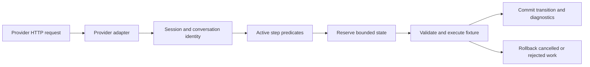

# Typed conversation step graphs

Status: Locally qualified through running-server integrations and an installed-package consumer. This document describes the E3 contract;
it does not establish a completed test or public-package release claim.
Related: [architecture](../Architecture.md), [ADR-0004](../ADR/ADR-0004-conversation-step-graphs.md),
[sessions](TestSessions.md), [structured/tool fixtures](ToolAndStructuredFixtures.md),
[Responses continuation](ResponsesContinuation.md).

## Purpose and ownership

A conversation adds conditions to each step of a deterministic chat workflow. A step can reply with text,
structured JSON, one or several tool calls, or a scripted error, then transition to ordered alternative steps.
The graph is serializable configuration owned by the provider-neutral runtime. Provider packages continue to
normalize their own wire messages and render their own responses. Existing linear scenario queues remain available.



## Configuration and client flow

Configure through the core builder's `AddConversation`, a dataset's `AddConversation`, or the control client's
`UseConversation`. Every step needs exactly one response and either `Then(...)` or `Complete()`. The first
declared step is the start unless `StartAt(...)` selects another. The default model is `gpt-4.1-mini`.

```csharp
await server.ConfigureAsync(config => config
    .UseGpt41Mini()
    .UseConversation("approval", graph => graph
        .Step("ask", step => step
            .WhenLatestUserEquals("Start").WhenTurn(1)
            .Responds("Approve or cancel?").Then("approve", "cancel"))
        .Step("approve", step => step
            .WhenLatestUserEquals("Approve").WhenTurn(2)
            .Responds("Approved").Complete())
        .Step("cancel", step => step
            .WhenLatestUserEquals("Cancel").WhenTurn(2)
            .Responds("Cancelled").Complete())));

using var conversation = server.ForConversation("approval-test");
using var chat = conversation.Control.CreateChatClient();
// Send Start, then the returned assistant message and Approve as full chat history.
var states = await conversation.Control.GetConversationsAsync();
```

`ForConversation` exposes `Id`, `HttpClient` and `Control`. Supply its `HttpClient` to official provider SDKs
with the server's allocated provider endpoint and provider credentials. The wrapper adds the conversation
header per request and keeps the parent transport usable after disposal. Disposing this wrapper does not
delete server state; reset/configure or disposal of the owning test session clears it.

## Rules and predicates

1. Identity is partitioned by owning test session, scenario identity, provider namespace, conversation ID and
   provider credential hash. The optional `X-Llm-Test-Server-Conversation` header defaults to `default`;
   an explicit value must be nonblank, at most 128 characters, and appear once. It selects state and is not
   an authorization credential. Session and provider authentication still apply.
2. Scenarios retain their configured precedence. A graph starts only when its start-step predicates match;
   once it has state for this identity, its active transition owns subsequent matching scenario requests.
   An active-step mismatch does not consume a response or fall through to a later scenario.
3. All predicates on a step must pass. `Then("first", "second")` selects the first matching target in that
   order. Step identifiers are case-sensitive. Text equality and contains predicates use ordinal matching.
4. `WhenLatestRole`, `WhenLatestTextContains`, `WhenLatestUserContains` and `WhenLatestUserEquals` inspect the
   final normalized message. They do not search historical user text. `WhenTurn` uses the logical turn index.
5. Logical turn is one plus the number of consecutive assistant-message groups in normalized history,
   ignoring system/developer messages. Parallel assistant function-call items form one group. HTTP attempts
   do not add turns. Clients supply full history or use supported stored Responses continuation.
6. `WhenToolResult(name, callId)` requires a final tool-result message and resolves its originating call ID
   in history. `WithToolArgumentsJson` compares that call's complete arguments by JSON structural equality.
   The call ID argument is optional; the originating tool name remains checked.
7. `WhenLatestJson(path, expectedJson)` and `WhenLatestJsonValue(path, value)` compare fields of the latest
   content by JSON structural equality. Paths support `$`, JSON Pointer including `~0`/`~1`, and the subset
   `$.property.items[0]`. Paths are limited to 256 characters. Wildcards, filters and recursive selectors are
   unsupported. Missing fields or malformed incoming JSON fail the predicate.
8. `Responds`, `RespondsJson`, `CallsTool`, `CallsTools`, `Fails` and `DelaysBy` reuse the existing fixture
   contracts. Tool choice, structured-output and streaming constraints are validated before advancement.

## Replay, errors and lifecycle

`ReplaySuccessfulRequests` defaults to true. Repeating the last successful normalized request returns its
retained runtime result without advancing the graph. Request ID, streaming mode and `previous_response_id`
are excluded from the fingerprint; restored history and the remaining normalized request determine identity.
Provider adapters still apply their wire formatting, so replay is not a byte-for-byte HTTP response guarantee.
Only the latest successful result is replayable. Fixture constraints remain validated on replay.

With replay disabled, changed or repeated input cannot advance an already successful logical turn. A later
turn must contain the additional assistant history. A committed scripted error can transition to an explicitly
configured recovery step at the same logical turn. Only one step can be in flight for an identity; cancellation
rolls back its reservation. Rejected fixtures and history/state admission failures do not advance the graph.
Reset/configure/session deletion clear conversation state and supersede pending work through the existing
runtime generation/retirement contract.

| Boundary | HTTP result/code |
| --- | --- |
| Another step is in flight | 409 `conversation_busy` |
| No active target matches | 409 `conversation_step_mismatch` |
| Changed/stale input after a successful turn | 409 `conversation_turn_not_advanced` |
| Terminal graph with Reject policy | 409 `conversation_completed` |
| Execution limit reached | 409 `conversation_exhausted` |
| Conversation admission budget exceeded | 409 `conversation_capacity_exceeded` |
| Incompatible response fixture | 409 `llm_test_server_fixture_mismatch` |
| Reset/configure/retirement during pending work | 409 `llm_test_server_request_superseded` |
| Invalid graph or selector header | 400; configuration remains unchanged |

The terminal policy defaults to `Reject`. An identical successful replay takes precedence over terminal
handling. `RepeatLastResponse` reuses the final successful fixture for later inputs; `Restart` begins again
at the start step and clears that run's execution/visited-step counters. `WithMaxSteps` limits committed
executions within a run, including error steps and cycles, rather than HTTP attempts or successful replays.

## Bounds

`UseConversationCapacity(maximumConversations, maximumBytes)` on the control builder, or
`WithConversationCapacity(...)` on the core builder, sets runtime admission budgets. Defaults are 256
conversations and 16 MiB retained state. Zero capacity rejects new state. Reservations include bounded identity,
step metadata and the retained response; growth is checked before a delayed fixture starts. Completed states
remain until reset/configure/session disposal. There is no timer eviction, persistence or heap-size measurement.

A graph contains 1–256 uniquely identified steps and `MaxSteps` is 1–4096, default 64. Scenario, step and tool
identifiers are limited to 128 characters. A step must terminate or reference distinct known next steps.
Graphs cannot also contain the linear response queue. Invalid configuration is rejected atomically.

## Control APIs and diagnostics

Both endpoints use the selected runtime's control authorization and test-session headers.

| API | Contract |
| --- | --- |
| `GET /admin-api/conversations` | Status entries with scenario/provider/conversation IDs, busy/terminal state, executed steps, last turn, next and unvisited steps |
| `POST /admin-api/match/explain` | Body: `LlmTestServerMatchExplanationRequest` containing normalized `request` and `providerNamespace`; response explains candidate predicates and precedence without advancing state |

The conversation header filters the status list or selects the identity to explain. Without it the status API
lists the selected runtime's states and explanation uses `default`. The client exposes `GetConversationsAsync`
and `ExplainMatchAsync`. Explanations include logical turn, selected scenario/step, matched candidates,
shadowed candidates and mismatch field names. They do not execute a provider call, reserve a step, increment
fault counters or populate caches. Unvisited alternatives are diagnostics, not an assertion that a required
branch failed. Runtime events and request traces carry conversation ID, step ID, logical turn and replay metadata.

## Verification and completion criteria

Qualification must start the HTTP server and drive real HTTP/provider SDK requests. Required flows are ordered
branches, latest-message and turn matching, parallel tool calls/results, JSON paths, replay and error recovery,
all terminal policies, cycles, invalid graphs, count/byte limits, fixture rejection, cancellation and in-flight
reset/configure/delete. Verify isolation across sessions, providers, credentials and conversation IDs. Read
explanations/status/events to prove selection and no advancement from diagnostics. Keep linear scenario and
provider-contract regressions green. No direct runtime tests or source scans establish these behaviors.

```sh
dotnet format ManagedCode.LlmTestServer.slnx --verify-no-changes --no-restore
dotnet build ManagedCode.LlmTestServer.slnx --configuration Release --no-restore
dotnet test --project tests/ManagedCode.LlmTestServer.Tests/ManagedCode.LlmTestServer.Tests.csproj --configuration Release --no-build --verbosity normal
bash scripts/coverage.sh
```

Completion requires the focused HTTP/SDK cases, full integration suite, at least 90% production line coverage,
canonical Release build and independent installed-package consumer to pass. Results belong in the delivery
implementation ledger. The current full suite passed 722/722 with 91.34% production line coverage; the independent installed-package Aspire/SDK/Chromium consumer passed 1/1. Public package publication remains pending the combined delivery batch.
