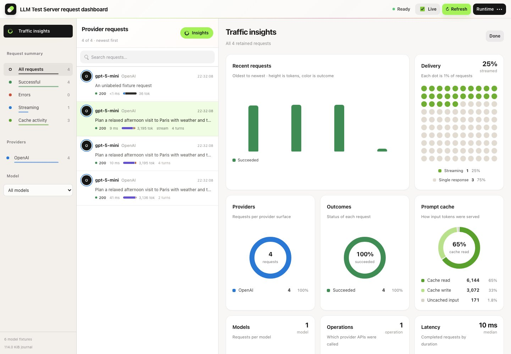

# Dashboard analytics

The request inspector has a **Tokens** tab that shows what a request, or an explicitly labeled conversation, is made of and how its tokens are billed. The default scope is the selected request. Conversation scope is available only when the caller supplied `X-Llm-Test-Server-Conversation`; it combines retained requests with that label, session and provider namespace. Models may differ inside that group. An automatically assigned or default conversation identity does not join unrelated requests.

## What the tab shows

- **Total, input, output and cached input** at the top, with reasoning shown as part of output.
- **Where the tokens go**: a flow (Sankey) chart. On the left, the input split by origin (system prompt, tool schemas, user, assistant, tool-call arguments, tool results) plus generated output. In the middle, the request total. On the right, the billing categories: cache read, cache write, uncached input, visible response and reasoning. Each node carries its token count and share.
- **Context mix**: a donut of the input composition with a value-and-share legend.
- **Prompt cache**: a donut of cache read, cache write and uncached input, plus how many requests read from the cache.
- **Context growth** (conversation scope with two or more requests): one stacked bar per request, oldest first, so context growth and cache reuse are visible turn by turn. Clicking a bar selects that request.
- **Function tools**: schema, call-argument and result tokens, then returned calls and in-context results per function name.

Each request row in the inbox also carries a small composition strip with the same colors, so a request dominated by its system prompt or tool results stands out before you open it.

## Traffic insights

The **Insights** button above the request inbox (and **Traffic insights** in the rail) switches the reading pane to charts over every retained request that matches the current filters. Open it directly with `/?view=insights`.

- **Recent requests**: one column per request, oldest to newest; height is total tokens and color is the outcome. Clicking a column opens that request.
- **Delivery**: a 10 × 10 dot grid of streaming versus single responses (each dot is 1% of requests).
- **Providers**, **Outcomes**, **Prompt cache**, **Tokens by model** and **Context mix**: donuts with a value-and-share legend.
- **Models** and **Operations**: labeled capsule bars.
- **Latency** and **Conversation depth**: columns for duration bands and messages per request.

Clicking a provider, model, outcome, delivery mode or operation applies the matching inbox filter; clicking it again clears it. Provider and model colors are assigned from the whole journal, so filtering never repaints the entries that remain. Entries past the seventh color slot fold into **Other**.

## Input composition

The runtime records `LlmTestServerTokenUsage.InputComposition` for chat-style requests on every provider surface. It counts each normalized message and tool schema with the same tokenizer that produces the reported input, so the parts add up exactly to `InputTokens`:

| Part | Source |
| --- | --- |
| System prompt | `system` and `developer` messages, including provider-level system fields |
| Tool schemas | function tool definitions: name, description and parameter schema |
| User | `user` messages |
| Assistant | assistant or model text from earlier turns |
| Tool calls | function-call identifiers, names and arguments inside assistant turns |
| Tool results | tool-result messages and blocks |
| Other roles | any other normalized role |

The composition is part of the request journal returned by `/admin-api/requests`, so tests can assert it directly. Usage without a reconciling composition, such as embeddings or media prompts, is shown as **Not itemized** rather than guessed.

## Tokens and cache

- Input tokens include cache-read and cache-write tokens.
- Output tokens include reasoning tokens.
- Total tokens equal input plus output; cache and reasoning subsets are never added again.
- Cached input share is summed cache-read tokens divided by summed input tokens.
- The cache-read request rate counts requests whose cached input is positive, divided by requests reporting usage. It does not claim that every request was eligible for its provider's cache.

Cache-write values come from normalized runtime accounting. A provider may expose only cache-read details on the wire; provider-specific mapping stays in the adapter. For example, Anthropic wire input usage can report uncached tokens separately from cache read and write, while the normalized trace input includes all three.

Conversation totals sum each retained request. Repeated prompt context counts again on each request, so the totals do not estimate unique conversation text, billing cost or external provider activity. Ratios use summed counts rather than averaging per-request percentages.

Requests without usage, such as model discovery, stay in the request count but contribute no invented measurements: figures show an em dash, ratios show `N/A`, and the flow chart shows an empty state.

## Function tools

**Calls returned** counts function calls in provider responses, including a replayed response returned for another request. **Results in context** counts tool-result messages supplied by callers. A later request may contain the same earlier result again, so results can exceed the number of distinct result call IDs. Result IDs are associated with preceding calls in the retained history; when that context is unavailable the dashboard shows an unknown-tool label. Neither calls nor results prove that an external function ran. These metrics cover function-tool contracts, not native hosted tools.

## Retention

Analytics use the same bounded request snapshot as the inspector. Short notices appear above the charts when earlier conversation requests were evicted, requests are still pending, usage is missing, or payloads were shortened; token counts stay complete when only payload previews were shortened. The dashboard adds no analytics endpoint; callers can inspect the underlying journal through the existing [query/export/verification APIs](RequestVerificationAndDeterminism.md).

See [architecture](../Architecture.md) and [conversation DSL](ConversationDSL.md). Running-server dashboard HTTP tests and browser tests provide the integration evidence.
