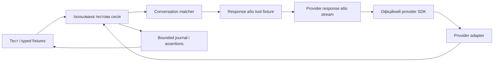

# ManagedCode.LlmTestServer: план розвитку та доставки

Статус: **погоджено власником; реалізація триває, весь roadmap E0–E13 у scope**.
Дата плану: 20 жовтня 2026 року.
Основа: [архітектура](../Architecture.md), [контракти провайдерів](ProviderApiContractCoverage.md),
[tool fixtures](ToolAndStructuredFixtures.md), [Responses continuation](ResponsesContinuation.md).

## 1. Мета

**LLM Test Server** — **Deterministic LLM API mocking for .NET and Aspire.**
Продукт має одну ідентичність: GitHub `managedcode/LlmTestServer`, NuGet/namespace сім’ю
`ManagedCode.LlmTestServer.*`, типи `LlmTestServer*` і image `ghcr.io/managedcode/llm-test-server`.
План охоплює багатокрокові розмови, well-known built-in tools, розширення provider API, fault simulation,
record/replay та повну інтеграційну перевірку опублікованих пакетів.

Підтримка доводиться через запущений сервер: HTTP, офіційні SDK, streaming і помилки.
Unit-тести, fake clients, читання source/docs та reflection guards не є прийнятними перевірками.
Оцінювання якості live моделей і реальне навчання не входять у deterministic mock runtime.

## 2. Поточні поверхні

19 пакетів: core, Hosting, Client, Aspire та 15 provider packages; 22 проєкти з двома samples і тестовим проєктом.
Provider packages: OpenAI, AzureOpenAI, Foundry, Anthropic, Gemini, Groq, Mistral, Ollama, Cohere,
Bedrock, OpenRouter, DeepSeek, Perplexity, SystemOne і Cloudflare.

Є linear response queues, scripted errors/delays, function tool loops, structured output, Responses continuation,
streaming, embeddings/image/audio/video fixtures, cache/reasoning/token accounting, Blazor dashboard, bounded
request journal, rate-limit/content-filter simulation і package-owned Aspire без Docker. Test sessions локально
кваліфіковані. E3 conversation graph та E4 request verification/query/export/fixed wire metadata локально
кваліфіковані; наступні етапи не є завершеними support claims.

E4 fixed-clock/seed режим задає generated wire IDs/time через session-owned provider-local ordinals; reset
відтворює послідовність, conversation replay зберігає response metadata. Live режим лишається доступним.
Explicit fixture timestamps/model dictionaries зберігають власні значення; runtime/trace observations та
monotonic retry timing залишаються реальними. Це не гарантія byte-for-byte однакових довільних HTTP bytes.

## 3. Цільові можливості

| Напрям | Результат | Інтеграційна перевірка |
| --- | --- | --- |
| Test sessions | Незалежні config, queues, history, cache, faults, journal | Паралельні клієнти, reset/dispose isolation |
| Conversations | Typed turns, branches, tool results, terminal policy | Повні HTTP/SDK loops у JSON і streaming |
| Built-in tools | Typed fixtures, native declarations/results, citations/events | SDK parsing, success/error, mixed tool loops |
| Reliability | Retry-After, timing, transport і semantic faults | Реальний HTTP/stream failure і результат повтору |
| Replay | Versioned cassettes, bytes/frames, strict offline | Відтворення без upstream при miss |
| Provider APIs | Moderation/rerank/count/discovery, lifecycle, media, realtime | Кожен claimed method/parameter/mode через сервер |
| Developer experience | Typed client, validation/import/export, diagnostics, installed Aspire | Чистий installed consumer, Chromium, SDK |
| Agent protocols | MCP/A2A/AG-UI та retrieval fixtures | Реальні protocol clients до hosted endpoints |

## 4. Ідентичність і випуск

Public API: `AddLlmTestServer`, `MapLlmTestServer`, `AddLlmTestServerContainer`; configuration key
`LlmTestServer:RequiredBearerToken` / `LlmTestServer__RequiredBearerToken`; diagnostic prefix
`llm_test_server_`. Усі package IDs, dependencies, targets, service assets, docs і screenshots використовують
один бренд і використовують наведені публічні ідентифікатори.

Погоджена версія combined batch — `1.0.0`; canonical version bump виконується один раз, коли весь batch
готовий. Порядок: branch changes → local quality gate → pack/installed consumer → release preflight →
owner merge через чинні gates → GitHub release/GHCR/NuGet → чистий consumer з public feed.
Часткову publication відновлювати для тієї самої версії. Не публікувати окрему версію на кожну зміну.
Release завершений лише після перевіреної публікації всіх 19 пакетів та container image і реального consumer flow.

## 5. Multi-turn і тестові сесії

Потрібно розширити вже наявну історію та tool loops, а не реалізовувати їх повторно.

1. **Session scope**: окремі configuration, scenario cursors, faults, assertions, cache, response/video/file/job stores. Session identity відокремлена від bearer authorization. Provider/credential isolation усередині history зберігається.
2. **Typed conversation DSL**: turns з умовами latest role/text, turn index, tool name/call ID/result, exact arguments/JSON path; explicit переходи, branches, terminal state, max steps і exhaustion policy.
3. **Семантика порядку**: turn index рахується з normalized conversation, retries того самого turn не стають автоматично новим turn; queued HTTP attempts і logical turns — різні поняття.
4. **Match explanations**: selected scenario/step, mismatch fields, shadowed/ambiguous rules, unused expectations. Пріоритет правил має бути документований і стабільний.
5. **Assertions**: count/order, tool arguments/results, no unexpected calls, all expected steps consumed, bounded retry attempts, Retry-After compliance, terminal stream marker.
6. **Без споживання при помилці**: validation/schema/authorization/session mismatch не пересувають сценарій. Cancellation/reset у межах session мають визначений результат для in-flight requests.
7. **Bounded lifetime**: кількість sessions, state bytes, journal retention та dispose/reset; переповнення повертає явну помилку. Тест однієї session не очищає іншу.

Control endpoints E2: `POST /admin-api/sessions`, `DELETE /admin-api/sessions/{id}` та session-scoped
configure/reset локально кваліфіковані. `GET /admin-api/requests` доступний із paging/filter. E3 додає
`GET /admin-api/conversations` і `POST /admin-api/match/explain`; інтеграційна кваліфікація пройшла.
E4 `POST /admin-api/verify`, розширений request query та `GET /admin-api/requests/export` локально
кваліфіковані. Наступні control API: fixture import/export/validate. Session headers і client factory описані
в [ADR-0003](../ADR/ADR-0003-isolated-test-sessions.md), conversation DSL — у [контракті](ConversationDSL.md).
Control routes залишаються під `/admin-api`, provider routes — у своїх namespaces.



## 6. Well-known та provider-native built-in tools

Цей блок додано за уточненням власника. Потрібні два різні рівні з єдиними fixtures/journal, але коректними provider wire contracts.

### 6.1. Готові function-tool fixtures

Реалізовано [typed function-tool catalogue](WellKnownFunctionTools.md) із дванадцятьма presets, input/output/error schemas та scripted success/error fixtures. Focused HTTP qualification: 40/40; combined server suite 852/852, production line coverage 91,79%, Release build 0 warnings/errors; 19 packages packed. Clean installed NuGet/Aspire/official SDK/Chromium consumer пройшов 1/1, включно з typed Calculator tool round. Це частина E5: native built-ins, dashboard discovery та розширена provider qualification залишаються відкритими.

Repo-owned presets: `Calculator`, `CurrentTime`, `Weather`, `WebSearch`, `FetchUrl`, `FileSearch`, `ReadFile`, `WriteFile`, `ListFiles`, `RunCode`, `Shell`, `ApplyPatch`. Це наші зручні test presets, а не універсальний міжпровайдерний стандарт назв function tools.

Кожен має typed argument/result schema, явні success/error fixtures, predictable call IDs, optional delay, expected-call verification та repeat/exhaustion rules. Час береться з fixture clock. Пошук і файли беруться із заданих test data. Tool loop може виконувати тестовий delegate через `Microsoft.Extensions.AI` function invocation; зовнішні побічні ефекти не входять у preset. Calculator не повинен виконувати довільний код через eval.

### 6.2. Нативні інструменти провайдерів

| Provider family | Кандидати до реалізації | Обов’язкові деталі |
| --- | --- | --- |
| OpenAI Responses | web search, file search, code interpreter, image generation, computer, shell/local shell, apply patch, tool search, remote MCP | Native tool types та output items, citations/annotations, call/result identity, lifecycle events, tool errors, approval items де застосовно |
| Anthropic | web search/fetch, code execution, tool search; client tools bash, text editor, computer/browser, memory | Точні versioned tool types, client/server execution distinction, block/event shapes, pause/resume, errors і required headers |
| Gemini | Google Search/Maps grounding, URL context, File Search, Code Execution | Native tool config, executableCode/codeExecutionResult, grounding/citation metadata, restrictions на combination/model/API |
| Azure/Foundry/Bedrock та інші | Лише native tool contracts, доступні на конкретній операції й версії | Не успадковувати всі OpenAI/Anthropic built-ins автоматично через схожий wire format |

Первинні джерела: [OpenAI tools](https://developers.openai.com/api/docs/guides/tools), [Anthropic tool reference](https://platform.claude.com/docs/en/agents-and-tools/tool-use/tool-reference), [client/server tool lifecycle](https://platform.claude.com/docs/en/agents-and-tools/tool-use/how-tool-use-works), [Gemini tools](https://ai.google.dev/gemini-api/docs/tools). Перелік — ціль аудиту контрактів; не кожна модель чи endpoint підтримує кожен інструмент.

Well-known catalogue повинен бути discoverable у C# та dashboard: provider, exact type/version, input/output schema, fixture examples, JSON/stream support, обмеження, evidence tests. Спочатку web search + file search + code execution для трьох головних wire families; далі computer/browser/shell/patch/memory/tool-search/MCP. Усі відповіді scripted; mock не стає реальним браузером, shell executor або пошуковиком.

Негативні fixtures model output вводити явним fault API. Звичайні `CallsTool`/`RespondsJson` продовжують відхиляти некоректні arguments/schema; їхню чинну валідацію не послаблювати заради fault simulation.

## 7. Реєстр API-прогалин

Шляхи нижче показують запропонований hosted namespace. Точні operation IDs, versions, request/response та streaming режими додаються до `ApiContract` тільки разом з реалізацією й evidence. Provider lifecycle моделюється bounded fixtures, а не реальним inference/training.

| Пріоритет / група | Відсутні API або частина контракту | Контракт / межа |
| --- | --- | --- |
| P1 moderation | `POST /openai/v1/moderations` | [Official API](https://developers.openai.com/api/reference/resources/moderations/methods/create); configured classifications |
| P1 rerank | `POST /cohere/v2/rerank`; Voyage rerank окремим provider surface | [Cohere](https://docs.cohere.com/reference/rerank); configured scores та порядок |
| P1 token counting | Anthropic `/anthropic/v1/messages/count_tokens`, Gemini `:countTokens`, Bedrock CountTokens | [Anthropic](https://platform.claude.com/docs/en/api/messages/count_tokens), [Gemini](https://ai.google.dev/api/tokens); наявний accounting розширити endpoints |
| P1 model discovery | Anthropic/Gemini list/get, OpenAI get-model, Ollama tags/show | Provider metadata, pagination, unknown-model errors |
| P1 Ollama generate | `POST /ollama/api/generate` | [Official API](https://docs.ollama.com/api/generate); нині є chat/embed |
| P1 built-in tools | Native tool declarations/results/events у Responses/Messages/generateContent | Розділ 6; розширення існуючих API |
| P2 Responses lifecycle | GET/DELETE response, input items, cancel/background, Conversations CRUD/items | Створення/continuation у нас уже є; перевірити SDK lifecycle |
| P2 Files | upload/list/retrieve/content/delete, metadata/purpose, paging; Anthropic/Gemini variants | Поточний generated-video download не дорівнює загальному Files API |
| P2 Batches | create/list/retrieve/cancel/results; OpenAI JSONL, Anthropic batches, Gemini batch subset | Partial failures, poll states, output files, per-session limits |
| P2 Vector stores | CRUD/search/file attach/file batches | Scripted search hits, bounded storage та lifecycle |
| P2 fine-tuning | jobs create/list/get/cancel/events/checkpoints | Scripted job lifecycle без навчання |
| P2 native model formats | Bedrock InvokeModel Nova/Llama/Titan variants; OpenResponses profile | Окремі SDK/wire contracts для кожного body format |
| P2 new provider families | Vertex AI, xAI/Grok, Voyage AI, ElevenLabs, BytePlus Ark, fal.ai; OrcaRouter як candidate | Окремий контракт та SDK evidence для кожного |
| P2 media completeness | Provider-specific image/audio/video variants, queue/status/content/cancel, voice design | Розширити наявні fixtures, не дублювати реалізоване |
| P3 realtime | OpenAI Realtime/GPT-Live, Responses WebSocket, Gemini Live/Interactions | Event protocols, session state, cancellations, errors, audio/tool events |
| P3 agent protocols | MCP initialize/tools/resources/prompts/call, notifications/session/auth; A2A cards/tasks/messages/SSE/cancel; AG-UI streams | Окремі packages/ADR; LLM tool call та MCP server мають окремі контракти |
| P3 retrieval dependencies | Pinecone/Qdrant/ChromaDB subsets, Tavily search | Fixtures/filter/query/upsert у погодженій матриці |

Додатково: simulated usage/cost budgets з explicit pricing fixtures, imported provider-reported cost і rate-limit headers; це не актуальний billing calculator. SDK contract drift checks, route/OpenAPI catalogue, fixture lint, import/export, CLI або .NET tool для serve/validate/replay — частина developer experience backlog. Existing `ApiContract` можна використати для route catalogue, не заводячи друге джерело правди.

Для API з P2/P3 цей документ фіксує цільові API й proposed subset, а не завершений аудит upstream специфікації кожного методу. Перший крок відповідного етапу — закріпити точні official docs/version/SDK і method-level inventory; unresolved cells залишаються видимими й не потрапляють у support claims.

## 8. Reliability, transport та replay

- Deterministic timing: TTFT, інтервали/затримки кожного chunk, timeout/stall, cancellation; clock/seed ізольовані за session, без незадокументованої випадковості.
- Transport faults: connection abort, early clean end, malformed JSON/SSE, missing terminal event, invalid envelope/header; окремо від звичайного provider-shaped HTTP error.
- Semantic faults: invalid tool JSON/schema, unknown tool, duplicate call IDs, refused/empty/reasoning-only output, length stop. Catalogue має support applicability за provider/mode та journal evidence.
- Retry: scripted 429 + Retry-After → success, 5xx → fallback provider, non-retryable failure; assertions перевіряють фактичні timestamps/attempts. Production timings не підміняти фальшивими успішними результатами тесту.
- Record/replay: versioned cassette schema для request, provider/version, exact response bytes/headers, timed frames; matcher normalization і collision diagnostics; replay speed та offline strict mode.
- Recording лише explicit opt-in із дозволеним upstream і redaction secrets/PII перед записом. Default test/replay не має network fallback при miss. CI використовує repo-owned fixtures без live credentials.
- Одна cassette може містити кілька conversation steps і tool rounds; replay із session isolation, deterministic clock/IDs, unused fixture detection.

## 9. Етапи, залежності та оцінка

Оцінка — **людино-дні повноцінної інженерної роботи**, включно з tests/docs/self-review. Це planning range, не обіцянка календарного строку чи часу роботи агента. Exact upstream breadth, SDK обмеження й release permissions можуть її змінити. Після кожного етапу уточнювати залишок за фактичним diff і verification evidence.

| Етап | Результат | Залежність | Оцінка |
| --- | --- | --- | --- |
| E0 | Зафіксувати baseline checks, public API/route manifest, release preflight, scope decisions | Погодження плану | 1–2 |
| E1 | Єдина ідентичність 19 packages, GitHub/GHCR/docs, verified published consumer | E0 | 3–5 |
| E2 | Session isolation, bounded stores/lifecycle, typed session client | E1 | 6–10 |
| E3 | Conversation DSL, branches, matching explanations, tool-round semantics | E2 | 5–8 |
| E4 | [Request query/export, assertions, retry verification, stable clock/IDs](RequestVerificationAndDeterminism.md) | E2–E3 | 4–7 |
| E5 | [Well-known presets](WellKnownFunctionTools.md) + основні native search/file/code tools | E3–E4; file-search lifecycle узгодити з E9 | 10–16 |
| E6 | Timing, transport faults, semantic misbehavior catalogue | E2–E4 | 6–10 |
| E7 | P1 API: moderation/rerank/count/model discovery/Ollama generate | E2, contract inventory | 6–10 |
| E8 | Fixture validation/import/export та record/replay | E3–E4, E6 | 7–12 |
| E9 | Stateful platform: Files/Batches/Responses lifecycle/vector stores/fine-tune fixtures | E2, E7 | 12–20 |
| E10 | New providers/media/native formats; решта built-in tool families | E5, E7, E9 | 15–25 |
| E11 | Realtime/WebSocket/Live/Interactions | E2–E6, exact protocol spec | 12–20 |
| E12 | MCP/A2A/AG-UI/vector DB/search ecosystem | E2–E4, окремі ADR/contracts | 15–25 |
| E13 | Фінальні recipes/support matrix, packaged quickstart, screenshots, delivery acceptance | Кожен погоджений етап; тут підсумкова інтеграція | 3–5 |

Повний перелічений обсяг: **105–175 людино-днів**, до резерву. Резерв 25% на protocol/SDK/release
невизначеність: приблизно **130–220 людино-днів**. Погоджено весь E0–E13 roadmap. Етапи є контрольними
точками одного узгодженого delivery batch; support claims додаються лише після відповідних server checks.

## 10. Acceptance і перевірка

| ID | Потік | Критерій |
| --- | --- | --- |
| A1 | Clean consumer | Встановлює нову Aspire NuGet з public feed, стартує packaged service без Docker, SDK виклик і assertion проходять; Blazor assets завантажуються |
| A2 | Product identity | Кожен із 19 пакетів доступний; metadata/dependencies/targets використовують ManagedCode.LlmTestServer; GitHub/origin/GHCR перевірені |
| A3 | Public configuration | Приклади використовують лише LlmTestServer configuration keys, API names і diagnostic IDs; installed consumer підтверджує їхню поведінку |
| A4 | Multi-turn | user → tool → tool result → другий tool → final; text/stream; повтор user prompt і approve/cancel branch дають правильний результат |
| A5 | Parallel sessions | Два клієнти з однаковими model/prompt/credential мають незалежні cursors/journals; reset/dispose однієї session не змінює іншу |
| A6 | Failure boundaries | Невірна schema/tool/session/auth не споживає fixture; capacity overflow та in-flight reset/cancellation мають явний результат |
| A7 | Built-ins | Позитивний/негативний native tool flow, citations/result/error/stream events, змішаний function + built-in loop для кожного claimed contract |
| A8 | Resilience | 429/Retry-After → success; malformed/aborted/stalled stream; invalid tool args; negative outcome відрізняється від помилки mock configuration |
| A9 | Replay | Recorded/hand-authored cassette offline відтворює bytes, steps, usage і timing policy; secrets не зберігаються; miss не йде у network |
| A10 | Stateful API | Paging, cancel, partial failure, foreign session ID, max count/bytes, delete/reset перевірені через реальні SDK там, де існують |
| A11 | Provider support | Кожен новий method/mode/version має official reference, operation constant, hosting route та виконувану behavior evidence; negative cases теж покриті |
| A12 | UI/docs | Desktop/tablet/mobile з довгою розмовою та tool payload; оновлені screenshots, видимі session/step/fault metadata, збережена bounded retention |
| A13 | Reproducibility | У fixed-clock/seed режимі scripted wire повторюється; паралельні sessions не змінюють чужу sequence; diagnostics мають зрозумілу clock policy |

На кожному behavior change: focused regressions; для provider changes — provider contract/evidence tests і повний quality gate; Aspire behavior — AppHost реально запускається з test fixture. Production line coverage не нижче 90%.

Canonical verification commands:

```bash
dotnet tool restore
dotnet restore ManagedCode.LlmTestServer.slnx
dotnet format ManagedCode.LlmTestServer.slnx --verify-no-changes --no-restore
dotnet build ManagedCode.LlmTestServer.slnx --configuration Release --no-restore
dotnet test --project tests/ManagedCode.LlmTestServer.Tests/ManagedCode.LlmTestServer.Tests.csproj --configuration Release --no-build --verbosity normal
bash scripts/coverage.sh
python3 scripts/verify-package.py
python3 scripts/verify-release.py
git diff --check
```

Також pack усі `src/*/*.csproj`, перевірити nupkg contents/dependencies, запустити installed consumer на чистому restore із публічного NuGet feed; container path перевірити окремо. Після останніх code/format changes повторити canonical Release build. Publication complete лише після успішного release workflow, наявності всіх пакетів у intended feed та installed-consumer acceptance.

Validation skills під час реалізації: `mcaf-testing`, `run-tests`/`tunit` для focused regressions → provider/Aspire checks → `format` і canonical build/full tests → `coverlet`/`reportgenerator` coverage → package/release checks → `mcaf-code-review` фінального diff; frontend skills для змінених browser assets. Нові dependencies/boundaries потребують ADR, не створювати їх до вибору реалізації.

## 11. Журнал реалізації

Погоджено весь E0–E13 план. Етапи не скорочують objective до першої хвилі.

| Етап | Стан | Докази / залишок |
| --- | --- | --- |
| E0 | Baseline зафіксовано | `ddbf171`, Release build 0 warnings/errors; baseline suite 669/669 |
| E1 | Product identity локально реалізовано; public delivery pending | 19 package surfaces/22 проєкти; Release build, format, local pack та installed consumer пройшли. GitHub `managedcode/LlmTestServer`, origin і default branch `main` перевірені. Branded IDs/config повністю очищено; 19 nupkg metadata/entries перевірено без старих назв |
| E2 | Реалізовано й локально кваліфіковано | Незалежні runtime/journals, session ID/key, typed client, bounded admission, atomic configure/reset/dispose та retirement pending work. 655/655 integration tests, coverage 91,17%; installed consumer/Aspire/Chromium 1/1. [Контракт](TestSessions.md), [ADR-0003](../ADR/ADR-0003-isolated-test-sessions.md) |
| E3 | Реалізовано й локально кваліфіковано | [Conversation DSL](ConversationDSL.md), [ADR-0004](../ADR/ADR-0004-conversation-step-graphs.md); 722/722 integration tests, coverage 91,34%; format/Release build 0 warnings/errors; all 19 packages packed, independent installed Aspire/SDK/Chromium consumer 1/1 |
| E4 | Реалізовано й локально кваліфіковано | [Request evidence/verification/determinism](RequestVerificationAndDeterminism.md), [ADR-0005](../ADR/ADR-0005-request-evidence-and-wire-determinism.md); full suite 812/812, production line coverage 91,66%; final Release build 0 warnings/errors; 19 packages packed; independent clean installed NuGet/Aspire/official SDK/Chromium consumer 1/1. E4 branch CI ще не запущений |
| E5 | Частково реалізовано | [12 typed function-tool presets](WellKnownFunctionTools.md), явні success-root/error-envelope schemas, existing queue/graph lifecycle; 40/40 focused HTTP cases, combined suite 852/852, coverage 91,79%, Release build 0 warnings/errors, 19 packages packed (`artifacts/delivery/presets-coverage.log`). Clean installed NuGet/Aspire/official SDK/Chromium consumer 1/1 (`artifacts/delivery/presets-consumer.log`), включно з Calculator tool round; native built-ins, dashboard discovery і provider qualification не завершено |
| E6–E13 | Не завершено | Увесь погоджений функціональний обсяг активний; support claims не розширюються наперед |

Гілка `codex/llm-test-server`, [PR1](https://github.com/managedcode/LlmTestServer/pull/1).
E3 CI [39446187097](https://github.com/managedcode/LlmTestServer/actions/runs/39446187097) успішний для
head `3aae4db`. E4 зміни ще не pushed до CI; локальна кваліфікація не підміняє цей майбутній gate.
Локальні E4 evidence logs: `artifacts/delivery/e4-build-final.log`, `e4-coverage-final.log`, `e4-pack.log` та
`e4-consumer.log`. Consumer встановив local NuGet artifacts у незалежний clean project/cache і реально
запустив packaged Aspire service, official SDK та Chromium; це не public-feed publication acceptance.
Public NuGet/GHCR publication, E5–E13 і GitHub Pages launch залишаються незавершеними.

Інтеграційні перевірки виявили й виправили model-list authorization, trace error metadata та browser dialog
layout. Docs screenshots і site hero отримано з реального browser run. Sessions доведені для 13 chat provider
families і native Jev/Kev/Clef/OpenAI decisions: JSON/SSE, cache/history/video/fault/journal isolation, auth,
count/byte/config boundaries, cancellation та in-flight reset/configure/delete.

## Launch preparation

The release target is v1.0.0, delivered as one complete batch on the current branch. The owner will merge when ready; do not merge or publish intermediate releases. The launch includes a GitHub Pages landing page in the dashboard visual language with shared styles/components, real screenshots and demo videos, a detailed mc-compact guide, the supplied launch content plan, and a public prebuilt Docker image configurable through the management API. Marketing production materials live in ignored marketing/ until the owner authorizes their publication.

Launch content reference: https://claude.ai/artifact/HHRF9Y8dzTbN8TJnaTKxnj

## First native-tool code checkpoint

[OpenAI native web-search fixtures](OpenAiNativeWebSearch.md) and [ADR-0006](../ADR/ADR-0006-ordered-native-tool-output.md) add typed ordered native/function/message output, provider-qualified declarations/options, URL citations, native SSE lifecycle, explicit/stored continuation, existing queue/graph/replay semantics and bounded structured query/export evidence. The initial completed search/ASCII-citation contract is qualified for gpt-4.1-mini; the preview SDK choice is not silently aliased. File search, code interpreter, broader native options/models/actions and the other E5 provider families remain active work.

Native focused tests passed 99/99; existing provider namespace/evidence passed 85/85. The current working-tree snapshot passed 966/966 with 91.94% production line coverage; format and final canonical Release build passed. All 19 packages were packed, the clean installed NuGet/Aspire/SDK/Chromium consumer passed 2/2 (including native JSON/SSE and a complete mixed function round), and a .NET SDK-built linux/arm64 image passed actual native HTTP smoke. Logs: `artifacts/delivery/native-web-*`; container evidence: `artifacts/container-verification/2cd0409b3d183025`. Parallel owner visual/token-composition work is not part of the upcoming code-only checkpoint, whose exact-head qualification is recorded separately. Cache checkpoint `d990e06` CI [39462950086](https://github.com/managedcode/LlmTestServer/actions/runs/39462950086) and website validation [39462950106](https://github.com/managedcode/LlmTestServer/actions/runs/39462950106) passed.

The independent code-only checkout passed 965/965 server integrations after the ordinary-response regression fix, with 91.96% production line coverage, 77.38% branch coverage and 94.38% method coverage. Canonical formatting and Release build passed with 0 warnings/errors. These results exclude the parallel owner analytics/visual work. Evidence: `artifacts/delivery/native-isolated-final-{format,build,coverage}.log`.

The same code-only checkout packed all 19 packages; the fresh installed NuGet/Aspire/official SDK/Chromium consumer passed 2/2. Its .NET SDK-built linux/arm64 image passed actual HTTP native JSON/SSE and terminal-evidence acceptance. Evidence: `artifacts/delivery/native-isolated-{pack,consumer,container-publish,container-smoke}.log`; container evidence `artifacts/native-code-validation/artifacts/container-verification/220fcd85c2a76ed5`. No public package/image publication is claimed.

## Native file-search and code checkpoint

The bounded [OpenAI file-search/code fixture contract](OpenAiNativeFileCode.md) adds completed native calls, ordered file/container citations, include projections, code deltas, explicit/automatic container references and file filter/result admission. It uses the same queue/graph, history, cache, replay and evidence paths. File search is independently qualified for gpt-4o-mini and code interpreter for gpt-4.1; no retrieval or code execution occurs.

Focused running-server HTTP/SDK tests passed 191/191, including 24 exact-numeric regressions and 17 normalization cases. Existing web-search regressions passed 105/105. Exact numeric comparison corrects a demonstrated HTTP false match between 1e-29 and 2e-29; ID-shape and ordinary-group handling prevent normalization errors without weakening native history bounds. The code-only final qualification is recorded below. Other E5 families and E6–E13 remain unfinished.

### File/code code-only qualification

- Focused file/code HTTP/official SDK: 191/191, including 24 exact-number and 17 normalization cases.
- Existing web-search regression: 105/105.
- Full isolated server suite: 1158/1158; production line coverage 92.21%, branch coverage 78.21%, method coverage 94.55%.
- Canonical format verification and final Release build passed with 0 warnings/errors.
- All 19 packages packed. A .NET SDK `PublishContainer` linux/arm64 image passed actual web/file/code JSON/SSE, includes, citations, code deltas, management/auth/reset and terminal-evidence smoke.

Evidence: `artifacts/delivery/native-file-code-*`; container record: `artifacts/native-code-validation/artifacts/container-verification/bb0d14644caef9d4`. This checkout excludes the concurrent owner analytics/visual changes. Public package/image publication, owner merge and remaining E5–E13 work are not asserted by these local results.

The clean installed NuGet/Aspire/official SDK/Chromium consumer passed 3/3 from an isolated package cache, including independent file/code JSON/SSE and stored continuation. Evidence: `artifacts/delivery/native-file-code-consumer.log`.
