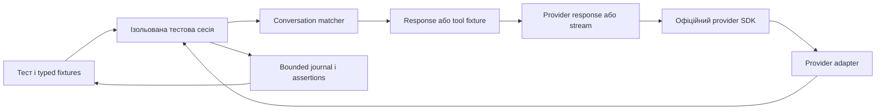

# ManagedCode.LlmTestServer: перейменування та розширення можливостей

Статус: **погоджено власником; реалізація триває, весь roadmap E0–E13 у scope**.
Дата дослідження: 20 жовтня 2026 року. Локальний baseline: `ddbf171`, версія `0.1.18`.
Основа: [архітектура](../Architecture.md), [контракти провайдерів](ProviderApiContractCoverage.md), [tool fixtures](ToolAndStructuredFixtures.md), [Responses continuation](ResponsesContinuation.md).

## 1. Мета та межі дослідження

Перейменувати продукт на **LLM Test Server**, GitHub-репозиторій на `managedcode/LlmTestServer`, усю NuGet-сім’ю та namespaces на `ManagedCode.LlmTestServer.*`. Позиціювання: **Deterministic LLM API mocking for .NET and Aspire.** Розширити підтримувані API, багатокрокові розмови та well-known built-in tools.

План спирається на поточні server API, provider contracts, офіційну документацію провайдерів, пакування та release workflow. Підтримка доводиться виключно інтеграційними перевірками запущеного сервера: HTTP, офіційні SDK, streaming і помилки. Unit-тести, fake clients, читання source/docs та reflection guards не є прийнятними перевірками й підлягають заміні. Оцінювання якості live моделей і реальне навчання не входять у deterministic mock runtime.

## 2. Поточний стан і масштаб

| Показник | Перевірений стан |
| --- | --- |
| NuGet package surfaces | 19: core, Hosting, Client, Aspire та 15 provider packages |
| Проєкти в Git | 22: 19 `src`, 2 samples, 1 tests |
| Поточні provider packages | OpenAI, AzureOpenAI, Foundry, Anthropic, Gemini, Groq, Mistral, Ollama, Cohere, Bedrock, OpenRouter, DeepSeek, Perplexity, SystemOne, Cloudflare |
| Файли з варіантами старої назви | 272 tracked files за `git grep -il -e llmtck -e llm-tck -e 'LLM TCK'`; це масштаб пошуку, не гарантія точного майбутнього diff |
| Публічні типи зі старим префіксом | 83 у статичному підрахунку оголошень C#; перед міграцією потрібна перевірка повної public API surface |
| GitHub | `managedcode/LlmTck`, `main`, поточний користувач має `ADMIN`; запит нової адреси повернув 404 |
| GitHub Pages | `has_pages=false`; керований GitHub Pages site зараз не ввімкнений. Окремий hosting `site` цим не перевірений |
| NuGet | Старий core має опубліковану `0.1.18`; усі 19 запропонованих нових IDs повернули 404 у flat-container index |

404 не резервує назву й не доводить право публікації: перед релізом перевірити NuGet ownership/prefix policy та scope publishing credential. Список repository secrets не показав записів; це не доводить відсутність organization/environment secrets. Доступність `NUGET_API_KEY` для workflow залишається release preflight-перевіркою, значення секретів читати не потрібно.

### Що вже є

| Можливість | Доказ у репозиторії | Межа |
| --- | --- | --- |
| Черги відповідей, scripted errors, затримка | `Scenarios/LlmTckScenarioBuilder.cs`, `Runtime/LlmTckRuntime.cs` | Є `Responds`, `CallsTools`, `RespondsJson`, `Fails`, `DelaysBy`; немає окремих match rules для кожного кроку |
| Повна історія повідомлень | `WithExactMatch`, `ScenarioFlowIntegrationTests`, `ToolFixtureEndpointTests` | Contains шукає серед усієї історії; ранній user prompt може продовжувати матчитися на наступних turns |
| Function calling і tool-result loop | `ToolFixtureClientTests`, `ToolFixtureEndpointTests` | Підтримка відрізняється за provider operation; generic function tool не означає підтримку provider-hosted built-ins |
| Responses continuation | `Runtime/LlmTckRuntime.ChatHistory.cs`, `LlmTckResponsesContinuationTests` | `previous_response_id`, `store=false`, bounded snapshots; OpenAI/Azure/Foundry. Retrieval/delete API не реалізовані |
| Structured output | `ToolAndStructuredFixtures.md`, `ProviderCapabilityEvidenceTests` | Фікстура валідовується; невідповідна schema/tool choice дає 409 без споживання відповіді |
| Streaming, embeddings, image/audio/video fixtures | Provider contracts і відповідні endpoint/SDK tests | Це не повний upstream API; native realtime/WebSocket немає |
| Cache/reasoning/token accounting | Runtime usage і `LlmTckAssertionSummary` | SessionId в OpenAI mapping використовується для cache identity; це не ізоляція всього тестового runtime |
| Dashboard і журнал | Hosting Blazor components, trace store | Діагностика bounded; відсутній повний public query/export/verification API для журналу |
| Rate limit/content filter | `Configuration/LlmTckFaultSimulation.cs`, `ProviderFaultSimulationTests` | Немає каталогу transport faults та дозованого псування model output |
| Aspire без Docker | `LlmTckAspireExtensions`, `buildTransitive`, `verify-package.py` | Пакет містить published service, assets та targets; простий build не перевіряє installed package experience |

На baseline E0 runtime був singleton: configure/reset очищали загальні queues, history, video, cache і journal. E2 додає незалежні runtime/journal та bounded registry через session ID/key, scoped DI й typed `await using` client; кваліфікація поточного стану наведена в журналі реалізації. Окремі hosts також підтримуються.

Окрема прогалина: у wire mappers використовуються `Guid.NewGuid()` і `DateTimeOffset.UtcNow`. Сценарні результати детерміновані, але byte-for-byte однакові response IDs/timestamps наразі не гарантовані.

## 3. Цільові можливості сервера

| Напрям | Результат | Інтеграційна перевірка |
| --- | --- | --- |
| Test sessions | Незалежні конфігурації, queues, history, cache, faults, journal | Два паралельні клієнти; reset/dispose однієї session не змінює іншу |
| Conversations | Typed turns, branches, tool results, terminal/exhaustion policy | Багатокрокові HTTP/SDK loops у JSON та streaming |
| Built-in tools | Typed fixtures, native declarations/results, citations/events | SDK parsing, success/error cases, змішаний function/built-in loop |
| Reliability | Retry-After, TTFT/chunk pacing, abort/stall/malformed/semantic faults | Застосунок отримує реальний HTTP/stream failure та заданий результат повтору |
| Replay | Versioned cassettes, exact bytes/frames, offline strict mode | Відтворення через сервер без upstream при miss |
| Provider APIs | Moderation/rerank/token count/model discovery, platform lifecycle, media, realtime | Кожен method/parameter/mode має позитивні й негативні server calls |
| Developer experience | Typed client, fixture validation/import/export, diagnostics, installed Aspire | Чистий installed consumer, Chromium та офіційні SDK |
| Agent protocols | MCP/A2A/AG-UI та retrieval fixtures | Реальні клієнти протоколів до запущених endpoints |

## 4. Перейменування: точний план

### Рекомендоване рішення

Повна source migration за один погоджений реліз. Зберегти 19 package boundaries. Нові NuGet IDs — нові пакети; існуючі пакети не «перейменовуються» на NuGet. Старі версії залишаються доступними; після перевірки нових вказати replacement package через deprecation metadata. Не додавати facade-пакети: dependency-only shim не відновить перейменовані namespaces/types. Якщо потрібна binary/source compatibility зі старими типами, це окремий додатковий обсяг.

Рекомендований номер для source-breaking rebrand: `0.2.0`, остаточно звірити з актуальною версією перед релізом. Для confirmed defects в одному owning repository зберігається правило одного combined repair batch і одного patch release; тут зміна ідентичності/API потребує окремого versioning рішення. Не робити release на кожен перейменований пакет або виправлений дефект.

| Поверхня | Заміна та перевірка |
| --- | --- |
| Repo | `managedcode/LlmTck` → `managedcode/LlmTestServer`; rename існуючого repo зі збереженням історії/issues/stars, потім origin URL |
| Solution/projects/directories | `ManagedCode.LlmTck*` → `ManagedCode.LlmTestServer*`, project references, тестовий проєкт, samples, Dockerfile |
| Усі 19 package IDs | Заміна `ManagedCode.LlmTck` на `ManagedCode.LlmTestServer` зі збереженням suffix; внутрішні dependencies лише на нову сім’ю |
| Public API | `LlmTck*` / `ILlmTck*` → `LlmTestServer*` / `ILlmTestServer*`; `AddLlmTestServer`, `MapLlmTestServer`, `AddLlmTestServerContainer` |
| Aspire package internals | DLL/service locator, packaged directory, `buildTransitive/*.targets`, MSBuild properties/items, static Blazor assets, resource default name |
| Config | Основний ключ `LlmTestServer:RequiredBearerToken` і `LlmTestServer__RequiredBearerToken`; рекомендовано тимчасово читати legacy key з явним new-key precedence, без прихованих HTTP route aliases |
| Wire-visible diagnostic IDs/codes | Окремий перелік `llm_tck_*`, `llmtck-*`, `msg_llmtck_*`; рекомендовано зберегти старі diagnostic error codes у rebrand release й документувати їх, щоб не змішувати branding із protocol behavior |
| GHCR | Новий image `ghcr.io/managedcode/llm-test-server`, OCI source labels, Aspire constants, Docker samples; старі published tags не видаляти |
| Automation | CI/release paths, scripts, coverage paths, package consumer tests, release assets/version guard; перевірити scoped credentials і permissions нового GHCR package |
| Product/docs | README, homepage metadata/links, badges, dashboard title, screenshots, code snippets, migration table, root/project AGENTS instructions |
| Local checkout | Фізичне перейменування `/Developer/LlmTck` опційно після закриття процесів і оновлення Codex project path; не переносити активний checkout посеред роботи |

Порядок delivery: підготувати зміни в branch → повні локальні checks і package consumer → перевірити release preconditions → перейменувати існуючий GitHub repo та оновити origin → повторно перевірити branch/protection/settings → merge/push погодженого релізу через чинні gates → стежити за CI/GHCR/NuGet → clean consumer з публічного feed → позначити legacy packages replacement metadata. Частково успішна NuGet publication відновлюється для тієї самої версії; не створювати нову версію для кожного повтору.

GitHub зазвичай перенаправляє repo traffic і Git operations, але project-site URLs та посилання на hosted actions потребують окремої уваги; стару назву repo не займати повторно. Джерело: [GitHub rename](https://docs.github.com/en/repositories/creating-and-managing-repositories/renaming-a-repository). NuGet replacement workflow: [Microsoft deprecation guide](https://learn.microsoft.com/en-us/nuget/nuget-org/deprecate-packages).

Rollback: до publication можна повернути локальний diff/rename контрольованою зміною. Після publication старі consumers продовжують використовувати старі пакети, а проблему нового релізу виправляє coordinated follow-up release. Видалення пакетів чи Git history rewrite не є rollback strategy.

## 5. Multi-turn і тестові сесії

Потрібно розширити вже наявну історію та tool loops, а не реалізовувати їх повторно.

1. **Session scope**: окремі configuration, scenario cursors, faults, assertions, cache, response/video/file/job stores. Session identity відокремлена від bearer authorization. Provider/credential isolation усередині history зберігається.
2. **Typed conversation DSL**: turns з умовами latest role/text, turn index, tool name/call ID/result, exact arguments/JSON path; explicit переходи, branches, terminal state, max steps і exhaustion policy.
3. **Семантика порядку**: turn index рахується з normalized conversation, retries того самого turn не стають автоматично новим turn; queued HTTP attempts і logical turns — різні поняття.
4. **Match explanations**: selected scenario/step, mismatch fields, shadowed/ambiguous rules, unused expectations. Пріоритет правил має бути документований і стабільний.
5. **Assertions**: count/order, tool arguments/results, no unexpected calls, all expected steps consumed, bounded retry attempts, Retry-After compliance, terminal stream marker.
6. **Без споживання при помилці**: validation/schema/authorization/session mismatch не пересувають сценарій. Cancellation/reset у межах session мають визначений результат для in-flight requests.
7. **Bounded lifetime**: кількість sessions, state bytes, journal retention та dispose/reset; переповнення повертає явну помилку. Тест однієї session не очищає іншу.

Control endpoints E2: `POST /admin-api/sessions`, `DELETE /admin-api/sessions/{id}` та session-scoped configure/reset реалізовані, перевірка триває. `GET /admin-api/requests` реалізований раніше. Наступні заплановані endpoints: `POST /admin-api/sessions`, `DELETE /admin-api/sessions/{id}`, session-scoped configure/reset/verify, `GET /admin-api/requests` з paging/filter, fixture import/export/validate та `POST /admin-api/match/explain`. Session headers і client factory визначені в [ADR-0003](../ADR/ADR-0003-isolated-test-sessions.md); control routes залишаються під `/admin-api`, provider routes — у своїх namespaces.



## 6. Well-known та provider-native built-in tools

Цей блок додано за уточненням власника. Потрібні два різні рівні з єдиними fixtures/journal, але коректними provider wire contracts.

### 6.1. Готові function-tool fixtures

Рекомендовані repo-owned presets: `Calculator`, `CurrentTime`, `Weather`, `WebSearch`, `FetchUrl`, `FileSearch`, `ReadFile`, `WriteFile`, `ListFiles`, `RunCode`, `Shell`, `ApplyPatch`. Це наші зручні test presets, а не універсальний міжпровайдерний стандарт назв function tools.

Кожен має typed argument/result schema, явні success/error fixtures, predictable call IDs, optional delay, expected-call verification та repeat/exhaustion rules. Час береться з fixture clock. Пошук і файли беруться із заданих test data. Tool loop може виконувати тестовий delegate через `Microsoft.Extensions.AI` function invocation; зовнішні побічні ефекти не входять у preset. Calculator не повинен виконувати довільний код через eval.

### 6.2. Нативні інструменти провайдерів

| Provider family | Кандидати до реалізації | Обов’язкові деталі |
| --- | --- | --- |
| OpenAI Responses | web search, file search, code interpreter, image generation, computer, shell/local shell, apply patch, tool search, remote MCP | Native tool types та output items, citations/annotations, call/result identity, lifecycle events, tool errors, approval items де застосовно |
| Anthropic | web search/fetch, code execution, tool search; client tools bash, text editor, computer/browser, memory | Точні versioned tool types, client/server execution distinction, block/event shapes, pause/resume, errors і required headers |
| Gemini | Google Search/Maps grounding, URL context, File Search, Code Execution | Native tool config, executableCode/codeExecutionResult, grounding/citation metadata, restrictions на combination/model/API |
| Azure/Foundry/Bedrock та інші | Лише native tool contracts, доступні на конкретній операції й версії | Не успадковувати всі OpenAI/Anthropic built-ins автоматично через схожий wire format |

Первинні джерела: [OpenAI tools](https://developers.openai.com/api/docs/guides/tools), [Anthropic tool reference](https://platform.claude.com/docs/en/agents-and-tools/tool-use/tool-reference), [client/server tool lifecycle](https://platform.claude.com/docs/en/agents-and-tools/tool-use/how-tool-use-works), [Gemini tools](https://ai.google.dev/gemini-api/docs/tools). Перелік — ціль аудиту контрактів; не кожна модель чи endpoint підтримує кожен інструмент.

Well-known catalogue повинен бути discoverable у C# та dashboard: provider, exact type/version, input/output schema, fixture examples, JSON/stream support, обмеження, evidence tests. Спочатку web search + file search + code execution для трьох головних wire families; далі computer/browser/shell/patch/memory/tool-search/MCP. Усі відповіді scripted; mock не стає реальним браузером, shell executor або пошуковиком.

Негативні fixtures model output вводити явним fault API. Звичайні `CallsTool`/`RespondsJson` продовжують відхиляти некоректні arguments/schema; їхню чинну валідацію не послаблювати заради fault simulation.

## 7. Реєстр API-прогалин

Шляхи нижче показують запропонований hosted namespace. Точні operation IDs, versions, request/response та streaming режими додаються до `ApiContract` тільки разом з реалізацією й evidence. Provider lifecycle моделюється bounded fixtures, а не реальним inference/training.

| Пріоритет / група | Відсутні API або частина контракту | Контракт / межа |
| --- | --- | --- |
| P1 moderation | `POST /openai/v1/moderations` | [Official API](https://developers.openai.com/api/reference/resources/moderations/methods/create); configured classifications |
| P1 rerank | `POST /cohere/v2/rerank`; Voyage rerank окремим provider surface | [Cohere](https://docs.cohere.com/reference/rerank); configured scores та порядок |
| P1 token counting | Anthropic `/anthropic/v1/messages/count_tokens`, Gemini `:countTokens`, Bedrock CountTokens | [Anthropic](https://platform.claude.com/docs/en/api/messages/count_tokens), [Gemini](https://ai.google.dev/api/tokens); наявний accounting розширити endpoints |
| P1 model discovery | Anthropic/Gemini list/get, OpenAI get-model, Ollama tags/show | Provider metadata, pagination, unknown-model errors |
| P1 Ollama generate | `POST /ollama/api/generate` | [Official API](https://docs.ollama.com/api/generate); нині є chat/embed |
| P1 built-in tools | Native tool declarations/results/events у Responses/Messages/generateContent | Розділ 6; розширення існуючих API |
| P2 Responses lifecycle | GET/DELETE response, input items, cancel/background, Conversations CRUD/items | Створення/continuation у нас уже є; перевірити SDK lifecycle |
| P2 Files | upload/list/retrieve/content/delete, metadata/purpose, paging; Anthropic/Gemini variants | Поточний generated-video download не дорівнює загальному Files API |
| P2 Batches | create/list/retrieve/cancel/results; OpenAI JSONL, Anthropic batches, Gemini batch subset | Partial failures, poll states, output files, per-session limits |
| P2 Vector stores | CRUD/search/file attach/file batches | Scripted search hits, bounded storage та lifecycle |
| P2 fine-tuning | jobs create/list/get/cancel/events/checkpoints | Scripted job lifecycle без навчання |
| P2 native model formats | Bedrock InvokeModel Nova/Llama/Titan variants; OpenResponses profile | Окремі SDK/wire contracts для кожного body format |
| P2 new provider families | Vertex AI, xAI/Grok, Voyage AI, ElevenLabs, BytePlus Ark, fal.ai; OrcaRouter як candidate | Окремий контракт та SDK evidence для кожного |
| P2 media completeness | Provider-specific image/audio/video variants, queue/status/content/cancel, voice design | Розширити наявні fixtures, не дублювати реалізоване |
| P3 realtime | OpenAI Realtime/GPT-Live, Responses WebSocket, Gemini Live/Interactions | Event protocols, session state, cancellations, errors, audio/tool events |
| P3 agent protocols | MCP initialize/tools/resources/prompts/call, notifications/session/auth; A2A cards/tasks/messages/SSE/cancel; AG-UI streams | Окремі packages/ADR; LLM tool call та MCP server мають окремі контракти |
| P3 retrieval dependencies | Pinecone/Qdrant/ChromaDB subsets, Tavily search | Fixtures/filter/query/upsert у погодженій матриці |

Додатково: simulated usage/cost budgets з explicit pricing fixtures, imported provider-reported cost і rate-limit headers; це не актуальний billing calculator. SDK contract drift checks, route/OpenAPI catalogue, fixture lint, import/export, CLI або .NET tool для serve/validate/replay — частина developer experience backlog. Existing `ApiContract` можна використати для route catalogue, не заводячи друге джерело правди.

Для API з P2/P3 цей документ фіксує цільові API й proposed subset, а не завершений аудит upstream специфікації кожного методу. Перший крок відповідного етапу — закріпити точні official docs/version/SDK і method-level inventory; unresolved cells залишаються видимими й не потрапляють у support claims.

## 8. Reliability, transport та replay

- Deterministic timing: TTFT, інтервали/затримки кожного chunk, timeout/stall, cancellation; clock/seed ізольовані за session, без незадокументованої випадковості.
- Transport faults: connection abort, early clean end, malformed JSON/SSE, missing terminal event, invalid envelope/header; окремо від звичайного provider-shaped HTTP error.
- Semantic faults: invalid tool JSON/schema, unknown tool, duplicate call IDs, refused/empty/reasoning-only output, length stop. Catalogue має support applicability за provider/mode та journal evidence.
- Retry: scripted 429 + Retry-After → success, 5xx → fallback provider, non-retryable failure; assertions перевіряють фактичні timestamps/attempts. Production timings не підміняти фальшивими успішними результатами тесту.
- Record/replay: versioned cassette schema для request, provider/version, exact response bytes/headers, timed frames; matcher normalization і collision diagnostics; replay speed та offline strict mode.
- Recording лише explicit opt-in із дозволеним upstream і redaction secrets/PII перед записом. Default test/replay не має network fallback при miss. CI використовує repo-owned fixtures без live credentials.
- Одна cassette може містити кілька conversation steps і tool rounds; replay із session isolation, deterministic clock/IDs, unused fixture detection.

## 9. Етапи, залежності та оцінка

Оцінка — **людино-дні повноцінної інженерної роботи**, включно з tests/docs/self-review. Це planning range, не обіцянка календарного строку чи часу роботи агента. Exact upstream breadth, SDK обмеження й release permissions можуть її змінити. Після кожного етапу уточнювати залишок за фактичним diff і verification evidence.

| Етап | Результат | Залежність | Оцінка |
| --- | --- | --- | --- |
| E0 | Зафіксувати baseline checks, public API/route manifest, release preflight, scope decisions | Погодження плану | 1–2 |
| E1 | Повне перейменування 19 packages, GitHub/GHCR/docs, verified published consumer | E0 | 3–5 |
| E2 | Session isolation, bounded stores/lifecycle, typed session client | E1 | 6–10 |
| E3 | Conversation DSL, branches, matching explanations, tool-round semantics | E2 | 5–8 |
| E4 | Request query/export, assertions, retry verification, stable clock/IDs | E2–E3 | 4–7 |
| E5 | Well-known presets + основні native search/file/code tools | E3–E4; file-search lifecycle узгодити з E9 | 10–16 |
| E6 | Timing, transport faults, semantic misbehavior catalogue | E2–E4 | 6–10 |
| E7 | P1 API: moderation/rerank/count/model discovery/Ollama generate | E2, contract inventory | 6–10 |
| E8 | Fixture validation/import/export та record/replay | E3–E4, E6 | 7–12 |
| E9 | Stateful platform: Files/Batches/Responses lifecycle/vector stores/fine-tune fixtures | E2, E7 | 12–20 |
| E10 | New providers/media/native formats; решта built-in tool families | E5, E7, E9 | 15–25 |
| E11 | Realtime/WebSocket/Live/Interactions | E2–E6, exact protocol spec | 12–20 |
| E12 | MCP/A2A/AG-UI/vector DB/search ecosystem | E2–E4, окремі ADR/contracts | 15–25 |
| E13 | Фінальні recipes/support matrix, packaged quickstart, screenshots, delivery acceptance | Кожен погоджений етап; тут підсумкова інтеграція | 3–5 |

Повний перелічений обсяг: **105–175 людино-днів**, до резерву. Резерв 25% на protocol/SDK/release невизначеність: приблизно **130–220 людино-днів**. Це більший продукт, ніж перейменування.

Рекомендована перша хвиля: **E0–E7 + E13**, приблизно **44–73 людино-дні** до резерву: нова назва, sessions, conversation DSL, assertions, well-known/native tools, fault simulation і найкорисніші API gaps. Тільки rebrand з preflight і його docs/acceptance: приблизно **5–9 людино-днів**. Початковий мінімум E5 обмежити search/file/code; повний каталог GUI/shell/browser/memory завершується в E10.

Етапи — контрольні точки, а не вимога публікувати проміжну версію після кожної. Пакети релізити узгодженими batch відповідно до погодженого scope. Якщо власник погодить лише rebrand, його можна доставити окремо; якщо погодить combined first wave, до релізу завершити її agreed acceptance.

## 10. Acceptance і перевірка

| ID | Потік | Критерій |
| --- | --- | --- |
| A1 | Clean consumer | Встановлює нову Aspire NuGet з public feed, стартує packaged service без Docker, SDK виклик і assertion проходять; Blazor assets завантажуються |
| A2 | Rename | Кожен із 19 пакетів доступний; metadata/dependencies/targets використовують нові IDs; GitHub redirects/origin/GHCR перевірені |
| A3 | Source migration | Старий приклад мігрує за короткою mapping table; legacy config precedence і diagnostic codes задокументовані та перевірені |
| A4 | Multi-turn | user → tool → tool result → другий tool → final; text/stream; повтор user prompt і approve/cancel branch дають правильний результат |
| A5 | Parallel sessions | Два клієнти з однаковими model/prompt/credential мають незалежні cursors/journals; reset/dispose однієї session не змінює іншу |
| A6 | Failure boundaries | Невірна schema/tool/session/auth не споживає fixture; capacity overflow та in-flight reset/cancellation мають явний результат |
| A7 | Built-ins | Позитивний/негативний native tool flow, citations/result/error/stream events, змішаний function + built-in loop для кожного claimed contract |
| A8 | Resilience | 429/Retry-After → success; malformed/aborted/stalled stream; invalid tool args; negative outcome відрізняється від помилки mock configuration |
| A9 | Replay | Recorded/hand-authored cassette offline відтворює bytes, steps, usage і timing policy; secrets не зберігаються; miss не йде у network |
| A10 | Stateful API | Paging, cancel, partial failure, foreign session ID, max count/bytes, delete/reset перевірені через реальні SDK там, де існують |
| A11 | Provider support | Кожен новий method/mode/version має official reference, operation constant, hosting route та виконувану behavior evidence; negative cases теж покриті |
| A12 | UI/docs | Desktop/tablet/mobile з довгою розмовою та tool payload; оновлені screenshots, видимі session/step/fault metadata, збережена bounded retention |
| A13 | Reproducibility | У fixed-clock/seed режимі scripted wire повторюється; паралельні sessions не змінюють чужу sequence; diagnostics мають зрозумілу clock policy |

На кожному behavior change: focused regressions; для provider changes — provider contract/evidence tests і повний quality gate; Aspire behavior — AppHost реально запускається з test fixture. Production line coverage не нижче 90%.

Після перейменування canonical commands отримають нові paths:

```bash
dotnet tool restore
dotnet restore ManagedCode.LlmTestServer.slnx
dotnet format ManagedCode.LlmTestServer.slnx --verify-no-changes --no-restore
dotnet build ManagedCode.LlmTestServer.slnx --configuration Release --no-restore
dotnet test --project tests/ManagedCode.LlmTestServer.Tests/ManagedCode.LlmTestServer.Tests.csproj --configuration Release --no-build --verbosity normal
bash scripts/coverage.sh
python3 scripts/verify-package.py
python3 scripts/verify-release.py
git diff --check
```

Також pack усі `src/*/*.csproj`, перевірити nupkg contents/dependencies, запустити installed consumer на чистому restore із публічного NuGet feed; container path перевірити окремо. Після останніх code/format changes повторити canonical Release build. Publication complete лише після успішного release workflow, наявності всіх пакетів у intended feed та installed-consumer acceptance.

Validation skills під час реалізації: `mcaf-testing`, `run-tests`/`tunit` для focused regressions → provider/Aspire checks → `format` і canonical build/full tests → `coverlet`/`reportgenerator` coverage → package/release checks → `mcaf-code-review` фінального diff; frontend skills для змінених browser assets. Нові dependencies/boundaries потребують ADR, не створювати їх до вибору реалізації.

## 11. Рішення для погодження

Рекомендовані defaults: повне source rename без facade; нова версія `0.2.0`; provider/control routes збережені; legacy config alias на перехід із явним precedence; diagnostic error codes збережені на rebrand; 19 package surfaces; session і conversation first; built-ins спочатку search/file/code, далі решта каталогу; default offline і deterministic.

Власник може погодити весь roadmap, першу хвилю E0–E7, або лише rebrand. Рішення про повний binary compatibility layer, конкретний обсяг P2/P3 API, релізні межі, нові package surfaces і фізичне перенесення checkout залишаються видимими scope choices. Погодження потрібно згідно з прямим проханням власника спочатку надати план, а не через обмеження skill.

На момент завершення початкового дослідження GitHub, NuGet, package version, source API і release workflow не змінювались. Нижче фіксується подальша реалізація після погодження власником.

Перевірка плану: локальні Markdown-посилання існують, code fences збалансовані, Mermaid та 14 етапів присутні, `git diff --check` без помилок. Канонічний `dotnet build ManagedCode.LlmTck.slnx --configuration Release --no-restore` успішний: 0 warnings, 0 errors. Тести, coverage, pack і publication у межах планування не запускались; майбутня реалізація потребує всіх checks із розділу 10.

## 12. Журнал реалізації

Погоджено весь план. Рекомендовані defaults прийняті; межі релізу не скорочують objective до rebrand або першої хвилі.

| Етап | Стан | Авторитетні докази / залишок |
| --- | --- | --- |
| E0 | Baseline зафіксовано | `ddbf171`, Release build 0 warnings/errors, повний baseline suite 669/669. Snapshots public types/provider contracts і test log: `artifacts/llm-test-server-migration/baseline` |
| E1 | Локальне перейменування реалізовано, перевірка триває | 19 пакетів/22 проєкти, public prefixes, Aspire packaged paths/targets, GHCR identity, docs/site та config fallback. Перейменований Release build успішний. 629/629 integration tests, coverage 90,86%, усі 19 local packages та installed-consumer/Aspire/Chromium пройшли; фінальний format check і coordinated release ще попереду |
| E2 | Реалізовано й локально кваліфіковано | Незалежні runtime/journals, session ID/key, typed client, bounded count/config/state reservation, atomic configure/reset/dispose, retirement in-flight work. Повний suite 655/655, coverage 91,17%, build/format пройшли; installed NuGet consumer + packaged Aspire + Chromium 1/1. [Контракт](TestSessions.md), [ADR-0003](../ADR/ADR-0003-isolated-test-sessions.md) |
| E3–E13 | Не завершено | Увесь погоджений обсяг залишається активним; support claims не розширені наперед |

Гілка: `codex/llm-test-server`. Версію поки не підвищено: canonical bump виконується один раз, коли combined approved batch готовий до публікації. GitHub rename виконано: `managedcode/LlmTestServer`, origin оновлено, default branch `main` і його protection state збережені. Public NuGet publication і legacy-package deprecation ще не виконані.

Уточнення власника під час реалізації: лише integration tests через запущений сервер і реальні HTTP/SDK calls; unit/source/reflection guards замінюються серверними перевірками. Повне покриття API/параметрів — обов’язковий delivery criterion.

Інтеграційна міграція тестів: source/reflection/unit guards вилучено. Додано public `/admin-api/requests` з auth, paging/filter та bounded diagnostics. Реальні HTTP перевірки виявили й виправили відсутність authorization на чотирьох model-list routes та незаповнені error fields журналу. Нові server integrations охоплюють modality faults/auth, atomic invalid configure, history isolation/capacity/store=false, exact scenario/auth/exhaustion/cancellation. Повний integration-only прогін: 629/629, production line coverage 90,86%; Release build 0 warnings/errors. Installed consumer/browser, external delivery та наступні етапи залишаються незавершеними.

Installed consumer відновив локальні nupkg в ізольований cache, перевірив SHA-512, запустив packaged Aspire service, control client, official OpenAI SDK, native decision routes і Chromium. Browser integration виявив зайвий grid рядок від dialog host; `display: contents` і перевірка native alertdialog/геометрії усунули проблему. П’ять docs screenshots і site hero оновлено з реального browser run та візуально перевірено. HTMLHint пройшов. Public-feed acceptance ще не запускався, пакети не опубліковано.

E2 кваліфікація: 655/655 integration tests і 91,17% coverage; packaged consumer пройшов зі scoped session client.
Сесії доведені для всіх 13 chat provider families і native Jev/Kev/Clef/OpenAI decision contracts; JSON/SSE,
cache/history/video/fault/fixture/journal isolation, key/provider auth, count/byte/config boundaries, cancellation,
reset/configure/delete in-flight. Недопустимі JSON tool fixtures тепер дають HTTP 400 без зміни runtime.
Public release та весь E3–E13 scope залишаються активними.
