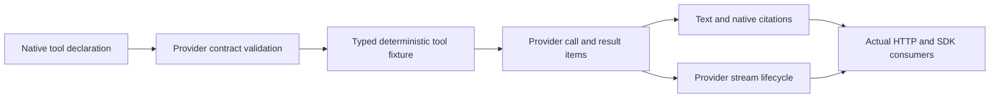

# Native built-in tool contract inventory

Status: **Bounded OpenAI completed web/file/code contracts locally qualified: file/code 191/191, web regressions 105/105, full server suite 1158/1158; remaining contracts proposed.**
Audit date: **2026-10-20**.
Scope: first E5 native search, file retrieval and code execution contracts for OpenAI Responses,
Anthropic Messages and Gemini generateContent. The bounded OpenAI completed-search subset is described in [its feature contract](OpenAiNativeWebSearch.md).
The additional [bounded file/code contract](OpenAiNativeFileCode.md) is implemented and locally qualified; public delivery remains pending.
Unresolved cells and other providers below remain prerequisites/proposed contracts, not support claims.
Related: [conversation DSL](ConversationDSL.md),
[request verification](RequestVerificationAndDeterminism.md), [existing function-tool fixtures](ToolAndStructuredFixtures.md).

## Implementation boundaries

Provider packages must own declarations, validation, native output items/blocks, citations and streaming events.
Core may own typed deterministic fixture data and ordered native tool results within conversation steps.
A native hosted tool is not equivalent to a user-defined function. Responses remain scripted: this work does
not execute searches, programs or external side effects. Every claimed option requires positive/negative
running-server HTTP and SDK evidence. Unknown or unresolved cells remain outside support claims.

## OpenAI Responses

Endpoint: upstream `POST /v1/responses`; hosted namespace `/openai/v1/responses`. Standard Bearer authentication.
Request-level `tools`, `tool_choice`, `include` and `stream` interact with each native tool.

| Contract | Proposed request support | Native result and citation contract |
| --- | --- | --- |
| `web_search` | `search_context_size`: low/medium/high; approximate `user_location`; domain filters; `external_web_access`; `return_token_budget`: default/unlimited | `web_search_call` with ID/status/action; search/open_page/find_in_page actions; output-text `url_citation` with URL/title/start/end; optional action sources via `include` |
| `file_search` | Required `vector_store_ids`; `max_num_results` 1–50; attribute filters; ranking options | `file_search_call` and queries; optional included results; `file_citation` containing file ID, filename and index |
| `code_interpreter` | Required container ID or auto container object; optional auto file IDs/memory tier | Code-interpreter call ID/container/code/outputs; generated artifacts cited as `container_file_citation` |

Web return-token budget applies to GPT-5+ reasoning web search; location is inapplicable to deep research.
Preview tool variants have different option applicability. Native prefixes and citation offsets must be preserved.
References: [web tool](https://developers.openai.com/api/docs/guides/tools-web-search),
[file tool](https://developers.openai.com/api/docs/guides/tools-file-search),
[request schema](https://developers.openai.com/api/reference/resources/responses/methods/create),
[code tool](https://developers.openai.com/api/docs/guides/tools-code-interpreter).

Streaming adds output-item lifecycle and `response.web_search_call.{in_progress,searching,completed}`,
`response.file_search_call.{in_progress,searching,completed}`,
`response.code_interpreter_call.{in_progress,interpreting,completed}` and
`response.code_interpreter_call_code.{delta,done}`. Each carries the relevant item/output index and sequence;
text/citations and final response completion must remain consistent with ordinary JSON output.
Reference: [streaming events](https://developers.openai.com/api/reference/resources/responses/streaming-events).

| Unresolved prerequisite | Required resolution before support claim |
| --- | --- |
| Tool-specific errors | Completed results are the implemented subset; failed/incomplete result/error relationships remain pending |
| File-search result spelling | Resolved as `results`; no alternate field is emitted. Bounded implementation is locally qualified |
| Expanded ranking options | Bounded ranker/threshold and comparison/compound filters implemented; hybrid weights remain unsupported pending separate qualification |
| Model applicability | Current independent pairings: web/gpt-4.1-mini, file/gpt-4o-mini, code/gpt-4.1; broader combinations remain pending |
| Containers/artifacts | Pin memory tiers, file download contracts, container reuse and bounded fixture ownership; coordinate with E9 lifecycle |
| SDK | Completed subset qualified through official .NET SDK JSON/SSE and a fresh installed-package consumer; broader native contracts still need independent qualification |

## Anthropic Messages

Endpoint: upstream `POST /v1/messages`; hosted namespace `/anthropic/v1/messages`. Standard `x-api-key` and
`anthropic-version` apply. Request includes model, max_tokens, messages, tools and optional stream.

### Web search

Types: `web_search_20250305`, `web_search_20260209`, `web_search_20260318`; fixed name `web_search`.
Options include max_uses, mutually exclusive domain allow/block lists, approximate location and allowed_callers.
The newest version adds response_inclusion; dynamic filtering starts with the 20260209 contract and depends on
model/code-execution capability. Results contain server_tool_use and web_search_tool_result blocks;
web_search_result_location citations identify URL/title and encrypted citation identity. Usage includes search count.
Tool failures can remain HTTP 200 with typed result errors; empty results are an empty list. Streaming carries
server-tool starts, input JSON deltas, result blocks and final message lifecycle.
Reference: [web-search contract](https://platform.claude.com/docs/en/agents-and-tools/tool-use/web-search-tool).

### Code execution

Types: `code_execution_20250825`, `code_execution_20260120`, `code_execution_20260521`; fixed name
`code_execution`. These versions do not require a beta header. The base contract supports Bash/file operations;
newer versions add programmatic calls/REPL behavior. Native sub-tool calls/results cover bash_code_execution and
text_editor_code_execution; outputs include stdout/stderr/return_code or typed file-operation results. Container
identity/expiry and explicit reuse are part of the contract. Streaming sends input_json_delta and whole result
blocks. Sonnet 4.5 is included in the documented code-execution model list.
References: [code contract](https://platform.claude.com/docs/en/agents-and-tools/tool-use/code-execution-tool),
[version directory](https://platform.claude.com/docs/en/agents-and-tools/tool-use/tool-reference).

### File retrieval and citations

An Anthropic Messages native `file_search` declaration was **not confirmed** in the tool directory. Do not invent
one. Documented retrieval uses a custom tool or supplied search_result content with source/title/text blocks
and citations.enabled. Output search_result_location citations carry source/index/block ranges. This is an
independent retrieval/citation capability, not a hosted file-search-tool claim.
Reference: [search-result contract](https://platform.claude.com/docs/en/build-with-claude/search-results).

| Unresolved prerequisite | Required resolution before support claim |
| --- | --- |
| Exact errors | Pin complete version-specific error codes and result unions for web/Bash/file operations |
| Version/model matrix | Validate newer tool versions, allowed_callers and programmatic capability per model |
| Nested execution | Pin caller envelopes, response_inclusion full/excluded and their interaction with direct calls |
| Continuation | Implement documented pause_turn/resumption and mixed client/server parallel-call behavior |
| Artifacts | Pin generated-file retrieval, container lifecycle and ownership without claiming unimplemented Files APIs |
| Streaming/SDK | Pin citation deltas, block indexes, tool-error streams and actual SDK parsing; verify complete native/function loops |

## Gemini generateContent

Use the generateContent-specific references below. Generic Gemini tool guides now also describe Interactions;
its `tools:[{type:...}]` declarations must not be copied into generateContent requests.
Endpoints: upstream `POST /v1beta/models/{model}:generateContent` and `:streamGenerateContent?alt=sse`;
hosted paths add `/gemini`. Standard `x-goog-api-key` authentication applies.

| Tool object | Request/output schema |
| --- | --- |
| `googleSearch` | Optional timeRangeFilter/searchTypes; candidate grounding metadata with search queries, sources, supports and searchEntryPoint |
| `fileSearch` | Required fileSearchStoreNames; optional metadataFilter/topK; retrieved grounding chunks/citations |
| `codeExecution` | Empty declaration; executableCode and codeExecutionResult content parts, matching optional IDs; PYTHON code and explicit execution outcome/output |

There are no date-versioned type IDs in these tool objects. The code outcomes are OUTCOME_OK,
OUTCOME_FAILED and OUTCOME_DEADLINE_EXCEEDED. Grounding streams must preserve incremental metadata semantics.
Reference: [generateContent REST schema](https://ai.google.dev/api/generate-content).

Search citations connect text segments to grounding chunks and web URI/title; searchEntryPoint carries search
suggestions. [GenerateContent search guide](https://ai.google.dev/gemini-api/docs/generate-content/google-search).
File-search model applicability includes Gemini 2.5 Pro/Flash-Lite and documented Gemini 3 models; do not infer
Gemini 2.5 Flash support from older examples. Upload/import/store lifecycle is separate from the generation
fixture. [File-search guide](https://ai.google.dev/gemini-api/docs/generate-content/file-search),
[code-execution guide](https://ai.google.dev/gemini-api/docs/generate-content/code-execution).

| Unresolved prerequisite | Required resolution before support claim |
| --- | --- |
| Model/tool combinations | Pin exact combinations, structured-output interaction and code-capable model list |
| File-search options | Pin metadata-filter grammar, topK bounds and invalid/foreign store behavior |
| Citation shapes | Pin the full retrievedContext and support/index schemas, including streamed incremental chunks |
| Tool errors | Pin search/file error shapes separately from execution outcome parts and top-level provider errors |
| Streaming | Exercise native results in actual SSE and supported JSON streaming response modes; do not invent named Responses-style events |
| SDK | Verify installed official SDK native parsing and mixed function/native flow before expanding package capability claims |

## Qualification and completion

For each selected operation/tool/version, check in the precise supported option/result/error subset alongside
official links and provider operation evidence. Run the server and test ordinary JSON, streaming, every claimed
parameter boundary, native errors, citations, identity consistency, mixed function/native conversation flows,
session isolation and fixture-capacity failure. Preserve deterministic wire metadata and real observations.

File/container/store references require explicit fixtures and ownership rules; unimplemented lifecycle APIs
remain visible E9 dependencies. No unresolved cell becomes a capability claim merely because a permissive DTO
accepts its JSON. No qualification result is asserted by this document.
