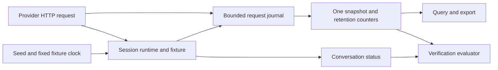

# Request evidence, verification and wire determinism

Status: Implemented and locally qualified through running-server integrations and an independent installed-package
consumer. E4 branch CI and public release remain pending.
Related: [architecture](../Architecture.md), [ADR-0005](../ADR/ADR-0005-request-evidence-and-wire-determinism.md),
[conversations](ConversationDSL.md), [sessions](TestSessions.md).

## Purpose and boundaries

Tests query the same bounded request journal used by the dashboard, export retained evidence, and submit
serializable expectations to the running server. Core owns public diagnostic/verification DTOs, matching and
wire metadata. Hosting owns request capture, retention and authenticated control endpoints. Client exposes
typed APIs without a dependency on Hosting. All evidence belongs to the selected test session.



## Query and export

`GET /admin-api/requests` returns a JSON array. `GET /admin-api/requests/export` uses the same query against
one captured snapshot and returns `LlmTestServerRequestExport`. Both enforce control authorization and session
selection. Querying and exporting do not execute provider operations or consume scenario responses.
The parsed model is attached to the existing HTTP trace as soon as the runtime receives the request.
Use `model=...&completed=false` to observe a delayed active invocation, including requests whose bounded
body preview is truncated. Completion updates the same request ID and sequence; this does not add runtime events.

| Query parameter | Meaning |
| --- | --- |
| `provider`, `model`, `requestId`, `status` | Exact provider ID, model ID, server attempt ID, HTTP status |
| `operation`, `scenario`, `conversation`, `step` | Exact operation/scenario/conversation/step ID |
| `streaming`, `completed`, `success` | Boolean filters; an in-progress request has no success outcome |
| `errorCode` | Exact retained provider error code |
| `from`, `to` | Inclusive real request-start timestamps |
| `order` | `desc` by default, or `asc`, ordered by journal sequence |
| `offset`, `limit` | Nonnegative offset; limit 1–500, default 500 |
| `format` on export | `json` by default, or `ndjson` |

Duplicate or blank supplied values, malformed values, invalid ranges and unsupported order/format return 400.
Status must be 100–599 and `from` must not follow `to`. String comparisons are exact. Control authorization
failure returns 401. Configure/reset clear the selected runtime's journal and evidence counters.

The array response also carries `X-Total-Count`, `X-Total-Observed`, `X-Evicted-Count`,
`X-Retained-Byte-Count` and `X-Retention-Truncated`. Total count is the filtered count before pagination.
The conversation selector header alone does not filter this endpoint; use its `conversation` query parameter.

`LlmTestServerRequestSnapshot` contains requests, `TotalMatched`, `TotalObserved`, `EvictedCount`,
`RetentionTruncated`, retained bytes and first/last retained sequence. Observed and eviction counters describe
the selected journal as a whole. Truncation is sticky until reset, including payload-preview truncation.
Sequence increases for each observed provider attempt; updates retain its original sequence. Default retention
is 500 entries and 16 MiB, with 64 KiB previews. Export is a bounded diagnostic snapshot, not a complete byte
recording or record/replay cassette.

The JSON export envelope has `schemaVersion: 1`, `query` and `evidence`. NDJSON sends one `type: metadata`
line with that version, query and evidence metadata, followed by `type: request` lines carrying each retained
entry. Metadata contains no duplicate request array. Pagination applies equally to both formats.

The client methods are `GetRequestsAsync`, `ExportRequestsAsync` and `ExportRequestsNdjsonAsync`, accepting
`LlmTestServerRequestQuery` from `ManagedCode.LlmTestServer.Diagnostics`. C# order values are
`LlmTestServerRequestOrder.Ascending` and `Descending`.

## Verification

`POST /admin-api/verify` accepts `LlmTestServerVerificationRequest`; `LlmTestServerClient.VerifyAsync` exposes
the same contract. A valid assertion returns HTTP 200 with `Passed`, `EvidenceComplete`, structured `Failures`
and `MatchedRequestIds`. A failed expectation is a verification result; malformed expectations return 400.
The conversation header scopes verification to that conversation before the body query is applied. Session
credentials and control authorization remain required. Verification does not change queues or graph state.

| Request property | Behavior |
| --- | --- |
| `Scope` | Shared request query applied before expectations |
| `Requests` | Named `LlmTestServerRequestExpectation` entries with query, minimum/maximum count, tools and optional terminal-marker requirement |
| `InOrder` | Each request expectation's matched sequence range follows the previous expectation's range |
| `NoUnexpectedCalls` | Every request in scope must be accounted for by a request or retry expectation |
| `Conversations` | Match scenario plus optional provider/conversation; require visited step IDs and/or terminal state |
| `Retries` | Match retry group and query; require attempt bounds, exact optional status sequence and Retry-After behavior |

The request supports at most 256 combined request/conversation/retry expectations. At least one expectation or
`NoUnexpectedCalls` is required. Request/tool count defaults are exactly one; a nullable maximum permits an
unbounded upper count within retained evidence. Each request expectation permits at most 64 tool expectations.
Tool-result expectations permit at most 64 JSON-field predicates; a conversation permits at most 256 required
step IDs. Invalid JSON and invalid count ranges are rejected before evaluation.

`LlmTestServerToolExpectation.Kind` selects `ResponseCall`, `RequestCall` or `Result`. Response calls come from
structured runtime response metadata. Request calls come from normalized assistant history. Tool results are
linked to preceding calls by call ID. Predicates cover name, call ID, structurally equal arguments, structurally
equal result JSON and JSON fields using the conversation selector syntax. Counts apply per matched request;
historical calls repeated across request histories remain observable in each history.

```csharp
var result = await session.Control.VerifyAsync(new LlmTestServerVerificationRequest
{
    Requests =
    [
        new()
        {
            Name = "completed chat",
            Query = new() { Provider = "openai", Success = true },
            MinimumCount = 1,
            MaximumCount = 1,
        },
    ],
    NoUnexpectedCalls = true,
});
```

## Incomplete evidence and terminal applicability

Verification cannot pass after journal eviction, retained/preview payload truncation, selected pending requests,
or pagination that excludes matching entries. `EvidenceComplete` is false and failures identify incomplete
journal/page/timing evidence. This rule is conservative across the selected journal, even if an expectation
filters to a smaller subset. A matched subset never proves that no other calls occurred after evidence loss.
Use a fresh session or reset and sufficient configured retention for a complete test flow.

Request traces preserve bounded structured tool calls and tool-result IDs in addition to payload previews.
`RequireStreamingTerminalMarker` requires both streaming classification and a successfully written/flushed
protocol terminal marker. Supported terminal shapes include OpenAI `[DONE]`/Responses completion, Anthropic
message stop, Cohere message end, Ollama `done`, Gemini final finish reason and Bedrock Converse stop/metadata,
plus image/transcription completion events. Exceptions and interrupted writes do not create terminal evidence.
Bedrock InvokeModel's current chunk format ends at EOF without an explicit terminal marker; do not request
terminal-marker verification for that operation. Successful transport completion alone is insufficient.

## Retry evidence

Set `X-Llm-Test-Server-Retry-Group` on each attempt in one logical retry flow. It is separate from the server's
unique request/attempt ID and selects evidence rather than granting access. The header must occur once, be
nonblank and contain at most 128 characters. Configure `.Fails(...).RetryAfter(seconds)` on a scenario or step
to emit deterministic `Retry-After` seconds for a scripted error. The delay is nonnegative and requires a
preceding error fixture. The application or real provider SDK performs the retry.

`LlmTestServerRetryExpectation` specifies group ID, query, minimum/maximum attempts (defaults 1–3), optional
exact status sequence, minimum advertised Retry-After and `RespectRetryAfter`. Retry checks examine 429/503
attempts. A retry expectation also accounts for its requests under `NoUnexpectedCalls`.

Trace start/completion store real UTC observations and independent `StartedMonotonicSeconds` /
`CompletedMonotonicSeconds` from `Stopwatch`. Retry spacing is measured from the preceding completion to the
next start with monotonic timestamps. Missing/nonfinite/reversed timing produces incomplete evidence.
`Retry-After` seconds are used directly; an HTTP-date is converted to a delay against the observed completion
UTC timestamp. The actual spacing comparison remains monotonic. Fixed fixture time never satisfies a real wait.

## Seeded wire metadata

Configure core with `WithDeterminism(seed, fixedUtc)` or the client with `UseDeterminism(seed, fixedUtc)`.
The serializable `LlmTestServerDeterminism` holds seed and UTC time. Seeds are nonblank and at most 256
characters. Without configuration, wire metadata uses live IDs/time.

The runtime reserves a provider-local request ordinal at provider request entry inside each session. Seed,
provider namespace and ordinal derive one metadata identity; `IdFor(domain)` derives IDs for response,
message and other wire fields. Each result carries `WireMetadata` with creation time, clock mode and sequence;
all chunks reuse it. Reset/configure restart provider counters. Provider requests, including failed attempts,
consume ordinals; control queries/explanations do not. Concurrent calls within one provider follow request-entry
ordering. Parallel sessions have independent counters, and calls to another provider do not advance this one.

Stored Responses and successful conversation replay retain response metadata, preserving fixture identity
across JSON and streaming. Provider prefixes and native field names remain provider-specific. Fixed mode also
sets the HTTP Date header from fixture time. This controls generated wire IDs/timestamps, not arbitrary fixture
fields: explicit model metadata, dictionaries and configured video timestamps retain their configured values.

Traces expose `WireClockMode`, `WireCreatedAt` and `WireSequence` alongside real observations. Initial request
metadata is enriched with actual runtime result metadata, including the retained metadata of a replay.
Runtime event timestamps, trace UTC observations, elapsed durations and monotonic retry evidence remain real.
Session IDs/access keys remain cryptographically random; seeds are fixture configuration, not credentials.
The mode does not introduce network calls or relax provider wire validation.

## Verification and completion criteria

Use running-server HTTP and official SDK tests for every query boundary, export format, auth/session scope,
count/order/unexpected-call assertion, tool history/result predicate, graph visited/terminal assertion, retry
status/delay and incomplete-evidence failure. Verify seeded reset/replay and JSON/stream identity across provider
families, media timestamps, independent sessions/provider counters and real diagnostic time.

Relevant suites include `RequestQueryExportIntegrationTests`, `VerificationIntegrationTests`,
`DeterminismIntegrationTests` and `NativeDeterminismIntegrationTests`. Completion additionally requires the full
integration suite, canonical Release build/format, at least 90% production line coverage and installed consumer.
Local qualification on 2026-10-20 passed 812/812 integration tests with 91.66% production line coverage;
the final Release build had zero warnings/errors. All 19 packages packed, and an independent clean NuGet
consumer exercised packaged Aspire, official SDKs, query/export/verification/fixed metadata and Chromium (1/1).
Evidence: `artifacts/delivery/e4-build-final.log`, `e4-coverage-final.log`, `e4-pack.log`, `e4-consumer.log`.
These local package checks do not establish public-feed availability. E4 branch CI has not run yet.

```sh
dotnet format ManagedCode.LlmTestServer.slnx --verify-no-changes --no-restore
dotnet build ManagedCode.LlmTestServer.slnx --configuration Release --no-restore
dotnet test --project tests/ManagedCode.LlmTestServer.Tests/ManagedCode.LlmTestServer.Tests.csproj --configuration Release --no-build --verbosity normal
bash scripts/coverage.sh
```
