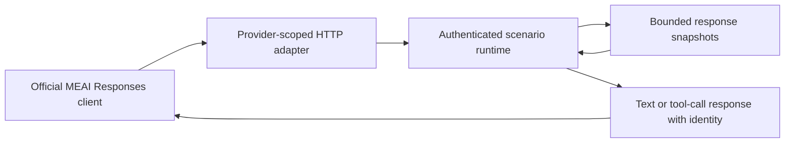

# Responses continuation

OpenAI, Azure OpenAI and Microsoft Foundry Responses creation preserves stored response context when an
official SDK sends `previous_response_id` with only the new tool output or user input. Streaming and ordinary
responses return the same runtime-owned response identity. Image/file input remains in normalized messages.

The provider-neutral runtime stores independent ordered snapshots of input plus assistant output/tool calls.
History is isolated by exact provider namespace and a hash of the supplied credential.
A continuation may select another model within that same provider and credential scope; it retains the
visible conversation, as described in [OpenAI conversation continuity](https://developers.openai.com/api/docs/guides/reasoning#preserve-reasoning-across-calls).
New request instructions replace earlier system/developer instructions, as required by the
[OpenAI Responses contract](https://developers.openai.com/api/docs/guides/migrate-to-responses) and
[Azure Responses contract](https://learn.microsoft.com/en-us/rest/api/aifoundry/azureopenai/responses).

`store=false` generates a response without retaining it. Unknown, foreign or reset parent identities return 404
before consuming a fixture. Reset and reconfiguration clear history. OpenRouter retains its documented stateless
behavior and rejects `store=true` or a non-null previous identity. Retrieval/deletion endpoints are outside this
creation/continuation contract.

Configuration owns `MaxStoredChatResponses` (default 256) and `MaxStoredChatResponseBytes` (default 16 MiB).
`WithChatResponseCapacity` and the client builder's `UseChatResponseCapacity` configure the same values.
Zero disables storage; negative values fail configuration validation. Capacity overflow returns 409 without
evicting history or consuming the configured response. Payload bytes plus per-record overhead bound retention.

Integration acceptance:

1. Ordinary and streaming official SDK tool loops reach scripted final responses with the original input and
   actual tool results visible through `/admin-api/assertions` (`LlmTestServerResponsesContinuationTests`).
2. Model changes preserve history in ordinary and streaming official SDK calls
   (`LlmTestServerResponsesContinuationTests`).
3. Foreign provider/credential parents, unknown/reset identities, disabled/full count/byte capacity, instruction
   replacement and `store=false` must be verified through server HTTP/SDK requests. Migration of these additional
   former internal cases is still in progress; do not infer coverage from the removed internal tests.
