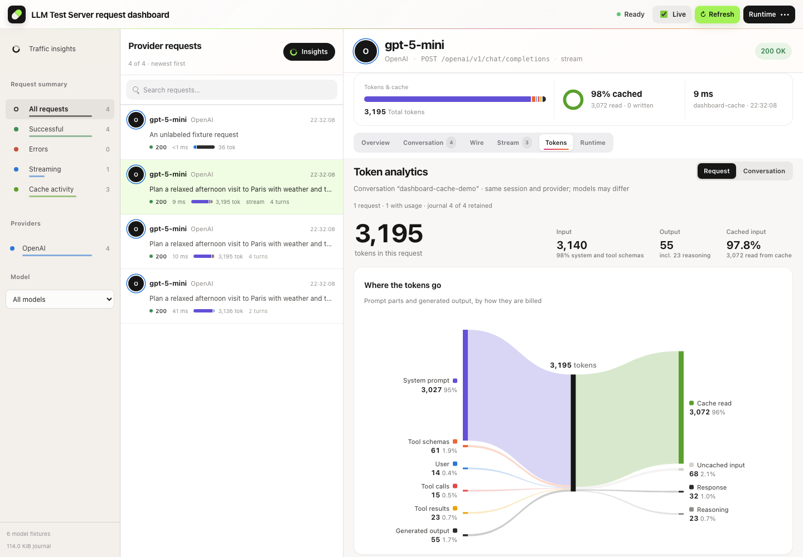
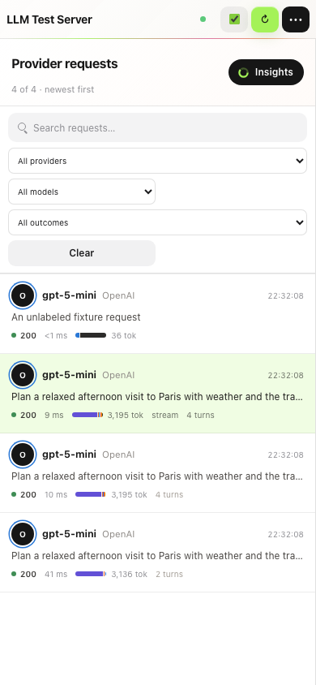

# Token usage and prompt-cache accounting

How deterministic token usage, reasoning tokens and prompt-cache reads/writes are computed and reported on every provider surface. For the per-role input composition and dashboard charts, see [dashboard analytics](../Features/DashboardAnalytics.md). Back to the [README](../../README.md).

## Control Panel And Token Usage

Open the Test Server resource endpoint from the Aspire dashboard to inspect the running configuration at `/`. The browser admin panel is rendered by Blazor server-side rendering from `ManagedCode.LlmTestServer.Hosting`. If the resource was configured with `.WithApiKey("test-key")` or `RequireBearerToken("test-key")`, enter the same token in the control panel before refreshing.

The dashboard is a request inbox: one row per provider call, with the request, response, conversation, wire payloads, stream chunks, token composition and runtime result for the selected call. The **Tokens** tab draws the token flow and prompt-cache donuts for a request or an explicitly labeled conversation, and **Traffic insights** (`/?view=insights`) charts all retained traffic; see [dashboard analytics](../Features/DashboardAnalytics.md). The **Runtime** dialog shows fixtures, provider routes, assertion counters and the event timeline. Auto-refresh is enabled by default and runs every 15 seconds on the server-side Blazor component; there is no client-side polling script and no visible countdown.

Token usage is counted with the repo-owned tiktoken-compatible counter and reported both as summary totals and per runtime event with `inputTokens`, `cachedInputTokens`, `cacheCreationInputTokens`, `outputTokens`, `reasoningTokens`, and `totalTokens`. Provider response envelopes also receive the same deterministic usage values: OpenAI-compatible chat and Responses usage including reasoning-token and prompt-cache details when configured, Anthropic sync messages and streaming `message_start`/`message_delta`, Gemini `usageMetadata` including long-running video operation results, Cohere chat usage, Ollama prompt/eval counts, and Bedrock Converse usage.

For reasoning-capable fixture models, configure a deterministic reasoning-token count on the model. LLM Test Server includes those tokens in `outputTokens` and exposes the split in `reasoningTokens`; OpenAI-compatible responses also include `completion_tokens_details.reasoning_tokens` or `output_tokens_details.reasoning_tokens`.

```csharp
options.AddGpt5Nano(reasoningTokens: 128);
```

## Prompt Cache Accounting

Prompt cache accounting is deterministic runtime state for testing provider usage handling. LLM Test Server does not call a real cache service and does not hide prompt text; it calculates repeated prompt-prefix usage from the requests that reach the runtime.

Cache entries are created only for successful chat or Responses requests on provider surfaces with a cache policy. A failed, unmatched, unauthorized, cancelled, unknown-model, or scripted-error request does not create a cache entry. `ConfigureAsync(...)` and `ResetAsync()` both clear prompt-cache entries so each test can start from a known cache state.

The cache key includes provider cache policy, model id, an optional provider cache key or session id, the rounded cacheable token count, and the cumulative message prefix. The first successful request with a cacheable prefix reports cache-write tokens and zero cache-read tokens. Ollama exposes cache reads only and does not report cache-write tokens. A later successful request with the same cache key reports cache-read tokens and zero cache-write tokens for the already cached prefix.

Provider cache thresholds follow the current runtime policy:

| Policy | Provider routes | Minimum cacheable tokens | Increment |
| --- | --- | ---: | ---: |
| OpenAI-compatible | OpenAI, Groq, Azure OpenAI, Microsoft Foundry, Perplexity, Responses API routes that use the OpenAI-compatible shape | 1024 | 128 |
| OpenRouter | OpenRouter chat and Responses routes; `session_id` or `x-session-id` can become the cache key when no explicit prompt cache key is sent | 1024 | 128 |
| DeepSeek | DeepSeek chat routes | 1024 | 128 |
| Anthropic | Anthropic Messages requests that include `cache_control` markers | 1024 | 128 |
| Mistral | Mistral chat routes | 64 | 64 |
| Gemini | Gemini generateContent routes | 2048 | 128 |
| Ollama | Ollama chat routes; deterministic cache reads only | 1 | 1 |
| Bedrock | Bedrock Converse requests that include `cachePoint` or `cache_control` markers | 1024 | 128 |

Cache accounting is a breakdown of input usage, not an extra billable token bucket. `totalTokens` remains `inputTokens + outputTokens`; `cachedInputTokens` and `cacheCreationInputTokens` explain how much of the input was read from, or written to, the deterministic prompt cache.

Provider envelopes expose the same runtime usage through provider-native field names:

| Provider surface | Cache fields returned |
| --- | --- |
| OpenAI, Groq, Azure OpenAI, Microsoft Foundry, Mistral, Perplexity chat | `usage.prompt_tokens_details.cached_tokens` |
| OpenAI, Groq, Azure OpenAI, Microsoft Foundry, Perplexity Responses | `usage.input_tokens_details.cached_tokens` |
| OpenRouter chat and Responses | `cached_tokens` plus `cache_write_tokens` in the matching prompt/input token details object |
| DeepSeek chat | `usage.prompt_cache_hit_tokens` and `usage.prompt_cache_miss_tokens` |
| Anthropic Messages | `usage.cache_creation_input_tokens` and `usage.cache_read_input_tokens` when cache usage exists |
| Gemini generateContent | `usageMetadata.cachedContentTokenCount` |
| Ollama chat | `prompt_eval_cached_count`, reported on the final NDJSON chunk for streaming |
| Bedrock Converse and ConverseStream metadata | `usage.cacheReadInputTokens` and `usage.cacheWriteInputTokens` |

[](../images/admin-dashboard-token-usage.png)

[](../images/admin-dashboard-mobile-request-detail.png)

OpenAI chat streaming supports `stream_options.include_usage`; the control library's `IChatClient` carries token usage and terminal updates, including reasoning and cache details. Authentication failures and scripted errors before generation do not accrue output/reasoning tokens.
